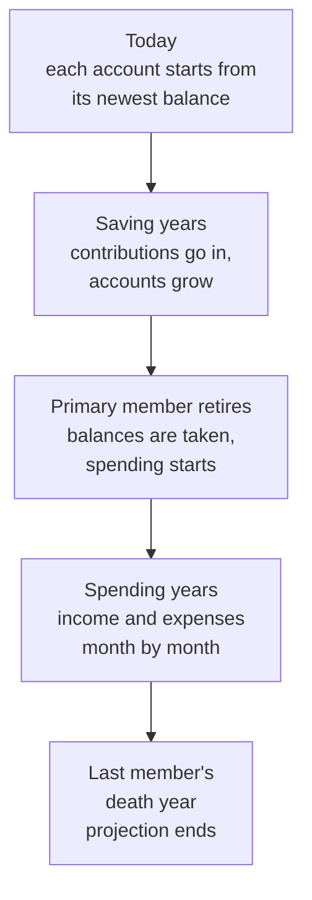

# How the math works: income, expenses and account returns

This page explains how RETIVO turns what you entered into the yearly figures
that every projection starts from: when the plan switches from saving to
spending, what each income stream pays, what each expense costs once prices
rise, what goes into each account, and how each account grows. It is for anyone
with basic personal-finance knowledge. You do not need to read code. For each
topic it says what the number means, what goes in, the steps in words, which
built-in figures are used, what the app simplifies, and where the code lives.
It is an explanation of the model, not advice: the results are estimates built
from what you entered.

Taxes on pensions, part-time pay and windfalls, Social Security, how the yearly
need is met from your accounts, and the Planned, Historical and Monte Carlo
bases are covered on other pages and named here in plain words. For where each
setting is on screen, see [Entering your data](user-guide.md#entering-your-data)
and [What the cards do](user-guide.md#inside-a-scenario). For how the
calculation engine fits into the app, see [architecture.md](architecture.md).

## The timeline

- **Retirement age** (a scenario card). Each member has an age in years and
  months. Their retirement date is their birthdate plus that age, keeping the
  birth day of the month. The projection uses the month. The **same date**
  option gives the other member exactly the anchor member's date instead of
  their own birthday-based date. A new **Base** scenario starts at 65 years,
  on the same date.
- **Life expectancy** (a scenario card). An age for each member. With none set,
  the app uses 95. No age can be set above 100. Death is taken as 31 December
  of the birth year plus that age, so a member counts as alive through the
  whole of that December. The projection runs through the later of the two
  death years.
- **Saving becomes spending at the primary member's retirement date.** Every
  account's balance is taken at that date, the end of the month before the
  retirement month. From then on the projection works through the household's
  income and expenses month by month.
- **Contributions stop at each account's owner's retirement date**, or today
  with **Stop contributing today**. An owner who retires before the primary
  stops earlier. An owner who retires after the primary keeps contributing,
  and those amounts arrive as deposits after the primary retires (see
  [Contributions](#contributions)).

A start or end on an income stream or expense can be tied to a moment in one of
these ways:

| Anchor | Start | End |
|---|---|---|
| Retirement | At retirement | Through December of the retirement year, plus any extra years you choose |
| An age | The month the member reaches that age | Up to, but not including, the month the member reaches that age |
| A year | January of that year | Through December of that year |
| A length of time | n/a | That many months after the start |
| Life | n/a | Through December of the death year. For an expense that is the primary, the spouse or whoever lives longest. For part-time pay it is the owner |

"Retirement" means the primary member's retirement for an expense. For a
pension or part-time stream it means the retirement of the stream's owner. An
age anchor on a member with no birthdate cannot be placed: the income stream or
expense counts as $0.

## Which amounts are in today's dollars

You enter most amounts at today's prices. The engine adds inflation for you,
but not to every amount.

| Amount | How the engine treats it |
|---|---|
| Expenses and one-off expenses | Today's dollars. Inflated from today to each month |
| One-off windfalls and plain pension lump sums | Today's dollars. Inflated from today to the month received |
| Planned contribution | Today's dollars. Grows by the annual increase, counted from today |
| Pension annuity monthly benefit | **Not** inflated to its start date. The amount you enter is what is paid in the first month. Its COLA applies from the following January |
| Part-time annual amount | **Not** inflated to its start date. The amount you enter is paid in the first year. Its COLA applies from the following January |
| Cash Balance Pension lump sum | Not entered. It is the account's projected balance in that month |

**COLA** (cost-of-living adjustment) is the yearly raise on a stream. It
compounds once a year, each January after the start year. A stream set to
**Use scenario inflation** uses the scenario's inflation rate as its COLA.
Otherwise it uses the percentage you entered. New streams start with that
switch on.

### Monthly steps and yearly roll-ups

The projection steps through the months. In each month a recurring amount
contributes one-twelfth of its yearly rate at that month's prices, and a
one-off is charged or received in full in its own month. The year-by-year
table and the other yearly figures add the same rules up by year instead, and
the Monte Carlo stress test reads income from the yearly roll-up too. Two
things differ, and they move numbers a little:

- A recurring expense with no glide that is active for part of a year counts its
  active months divided by 12, times the average of that year's twelve monthly
  inflation factors. The monthly steps use each active month's own factor.
- A pension or part-time stream is placed by month in the monthly steps, and by
  whole years in the roll-up. A pension that starts in March pays from March in
  the monthly steps but for the whole start year in the roll-up. A part-time
  stream that ends at an age is paid up to that month in the monthly steps. The
  roll-up pays the years before the year of that age and nothing in it.

The survivor share of a pension (below) starts in the same place in both: the
January after the pensioner's death year.

## Income

Income is of two kinds, and the difference matters.

- **Spendable income** lowers what has to be withdrawn from your accounts. It
  is pension annuities, part-time pay, and any one-off with no target account.
- **Deposits** go into an account and do not lower the need. They are pension
  lump sums and one-offs with a target account. Counting them as both a deposit
  and income would count the money twice.

The income form asks for a target account on every one-off windfall (a taxable
account) and every pension lump sum (a pre-tax retirement account), so in
practice both arrive as deposits. The **Income** card lets a scenario switch off,
change or add entries. This section describes the entries as the projection
reads them.

### Pension annuity

What goes in: **Monthly benefit ($)**, the start, the COLA, and the
**Joint-and-survivor benefit** choice (0%, 50%, 75% or 100%).

1. The benefit starts in the month the owner reaches the start age, or in the
   start year or retirement month you chose.
2. The yearly benefit is 12 times the monthly benefit, with no inflation added
   to reach the start date.
3. Each January after the start year, the benefit is multiplied by 1 plus the
   COLA.
4. **Joint-and-survivor** means that after the pensioner dies, a surviving
   spouse keeps a share of the benefit. From the January after the pensioner's
   death year, the benefit is multiplied by the chosen percentage. At 0% it
   stops. The share keeps its COLA raises.

### Part-time income

What goes in: **Annual amount ($)**, a start, an end and the COLA. The end is
required: a stream with no end pays nothing.

The amount is paid from the start month up to the end month, as one-twelfth a
month. Each January after the start year it is raised by the COLA.

### One-off windfalls and pension lump sums

A windfall (an inheritance or an asset sale, say) or a plain pension lump sum is
entered in today's dollars and inflated from today to the month it is received.
A start by age lands in the owner's birthday month, a start by year in January,
and a start at retirement in the retirement month.

Where the money goes:

- With a target account, it is a deposit. A deposit dated before the primary
  member retires joins the account during the saving years and then grows with
  it, unless the account's owner has already retired. Then it is not counted
  (see below).
- A deposit dated after the primary member retires depends on its kind. A
  pension lump sum enters its target account. A one-off windfall is not placed
  in its target account: it is spread across all the accounts in proportion to
  their balances, into each one's post-tax part.
- With no target account, it is spendable income in that month.
- In the saving years a deposit goes to the account's pre-tax part if the
  account is pre-tax, and to its post-tax part otherwise.

### Cash Balance Pension payout

A **Cash Balance Pension** account pays out through a pension income stream
linked to it. Exactly one linked stream must exist for each such account, and on
an individually owned account the stream must belong to the account's owner. If
there is none or more than one, projections are blocked until you fix it.

- **Annuity.** The stream's **Monthly benefit ($)** is paid like any other
  pension annuity, and the account's balance is no longer used for spending.
- **Lump sum.** The account's projected balance in the month the lump sum is
  received moves into the target account. If that month is after the primary
  member retires, the balance at retirement is grown at the account's planned
  return to that month. The target is a deposit as above.

Before retirement a Cash Balance Pension account is saved into like any other
account. It grows at its planned rate under every basis, Monte Carlo included.
It has no measured rate, and it ignores its asset mix and the **Asset
allocation** card below.

## Expenses

Each expense has an **Amount**, a **Frequency**, a **Classification** of
**Essential** or **Discretionary**, a category, a start and an end. A one-off
has a start and no end. The start and end work as in the table above. The
**Expenses** card lets a scenario switch off, change or add expenses. This
section describes the expenses as the projection reads them. The classification
changes an amount in one way: only discretionary expenses take the
**Discretionary adjustment**.

For one expense, the yearly figure is worked out like this:

1. **Yearly rate.** The amount times the number of payments a year: weekly 52,
   monthly 12, quarterly 4, yearly 1.
2. **Active months.** An expense is active from its start month up to, but not
   including, its end month. In a year it is only part of, it counts only the
   active months.
3. **Inflation.** Each month's amount is multiplied by that month's inflation
   factor (see below).
4. **Spending glide**, if the expense has one (see below).
5. **Discretionary adjustment**, if the expense is discretionary and the year
   falls in its window (see below).

A one-off expense is charged in full in one month: the birthday month for an
age start, January for a year start, the retirement month for a start at
retirement. It is inflated to that month. It is never glided. The Discretionary
adjustment does apply to a discretionary one-off.

An expense anchored to an age of a member with no birthdate is left out and
counts as $0.

### Inflation

The factor for a month is 1 plus the rate, raised to the power of the number of
months from today to that month, divided by 12. It is 1 today and grows from
there. There is one rate for each category, applied from today onward, not only
after you retire.

- The **general rate** is the scenario's **Inflation** setting. With none set,
  it is 3%. It can be set from 0% to 10%.
- A category flagged **Medical** starts at the general rate plus 2 percentage
  points.
- A rate you set for one category replaces both of the above for that
  category. It can be set from 0% to 10%.

Monte Carlo replaces the fixed rate with inflation drawn for each path. The
projections page covers it.

### Spending glide

A spending glide makes one expense's real spending rise or fall over
retirement. It works the same for an essential and a discretionary expense.
The multiplier on the amount is:

1. 100% until the glide starts.
2. A straight line, month by month, to the **end percentage** (0% to 200%) when
   the glide ends.
3. The end percentage from then on.
4. Optionally, a later step to a **floor** (for a falling glide) or a
   **ceiling** (for a rising one). A step that is not after the glide's end, or
   that sits on the wrong side of the end percentage, is ignored.

A glide starts and ends at retirement, at an age, in a year, or a set time after
the expense starts. It can also end when the expense ends. If the glide ends no
later than it starts, the expense moves to the end percentage in one step when
the glide starts. If a glide point cannot be placed, the glide is off for that
expense. The multiplier is applied to each month's amount after inflation.

### Discretionary adjustment

The **Discretionary adjustment** card raises or lowers optional spending by a
percentage from −100% to +100%. It multiplies discretionary expenses only, by 1
plus the percentage divided by 100. Essential expenses are untouched.

- **Window.** It applies for years counted from the retirement year of the
  primary member: either the whole of retirement, or the first N years. The
  retirement year is the first of those years. With a percentage set and no
  length chosen, the window is 10 years.
- **Stacking.** It multiplies on top of any spending glide on the same expense.

## Contributions

What goes in:

- The **Pre-Tax** and **Post-Tax** planned amounts for each account on
  **Annual Contributions**, and its **Annual increase**.
- The **company contributions** recorded on the account's newest **Account
  Balances** year.
- In a scenario, **Stop contributing today** on the **Future contributions**
  card, and the **Account contributions** card, which replaces the planned
  amounts or the annual increase for one account in that scenario.

The steps:

1. **Yearly amount.** The planned amount for the account's tax treatment (see
   the table under [Account growth](#account-growth)), plus the company
   contributions from the newest Account Balances year. The company amounts are
   taken from that one year and repeated for every year.
2. **Monthly amounts.** The yearly amount divided by 12. Each month's amount is
   added to the account just before that month's growth.
3. **Annual increase.** Each month's amount is multiplied by 1 plus the increase
   raised to the number of months from today, divided by 12. With
   **Match inflation** the increase is the scenario's inflation rate. An
   increase you set is a fixed rate, from −99% to 25%. A stored value that is not
   above −100% or is above 25% is ignored, and the account goes back to matching
   inflation. A month earlier this year than today gets slightly less than the
   amount you entered.
4. **When they stop.** At the owner's retirement date. With **Stop contributing
   today** on, every contribution is $0 from the start, including the deposits in
   the next step.
5. **After the primary retires.** An owner who retires later than the primary
   keeps contributing. For each month between the two dates the planned plus
   company amount, divided by 12 and without any annual increase, is deposited
   into the account, with its pre-tax and post-tax parts kept apart. Joint
   accounts get no such deposits: they stop contributing when the primary
   retires, or earlier if the member recorded as the owner retires earlier.

The contributions are your own planning targets. The app does not enforce any
IRS contribution limit, and a contribution does not lower any tax figure in the
projection.

## Account growth

What goes in: the account's newest **Account Balances** entry, its **Planning
Return %** (or the **Planned returns** card's rate for this scenario), its
tax treatment, and the contributions above.

### The monthly step

1. **Starting point.** The newest entry's ending balance is taken as the balance
   at the end of that year. The projection starts in January of the year after
   that entry, or in January of this year if that is later. So if the newest
   entry is older than last year, the missing years are not grown. An account
   with no entries is left out.
2. **Monthly rate.** The yearly planned return *r* is converted to the monthly
   rate (1 + *r*)^(1/12) − 1, so twelve months compound to exactly *r*. It is
   the same before and after retirement, unless the **Asset allocation** card
   replaces it.
3. **Each month**, add the month's contribution, then grow the balance by the
   monthly rate.
4. **Retirement.** Contributions stop at the retirement month, and the balance
   at that point is the starting balance for spending.

Which tax bucket an account's money sits in does not change its growth. It
decides what is seeded and what contributions are added:

| Tax treatment (account types) | Starting balance | Planned amount used | Company amount used |
|---|---|---|---|
| Pre-tax (Traditional IRA, 401(k), 403(b), 457(b), TSP, Cash Balance Pension, Other) | Pre-tax part | **Pre-Tax** | Company contributions |
| Post-tax (Brokerage, Savings, Money Market, CD, Other, TSP) | Post-tax part | **Post-Tax** | Company contributions |
| Roth (Roth IRA, Roth 401(k), 403(b), 457(b) and TSP) | Post-tax part | **Post-Tax** | Company contributions |
| HSA (health savings account) | Post-tax part | **Pre-Tax** | Company contributions |
| Mixed (401(k), 403(b), 457(b), TSP, Other) | The stored pre-tax and post-tax parts | Each of the two, into its own part | Each of the two company amounts, into its own part |

An HSA contribution is entered as pre-tax, because that is how it is paid, but
it grows in the tax-free part. Mixed accounts keep their two parts apart
throughout. The pre-tax part and the post-tax part grow at the same rate. The
taxes page lists which treatments each account type allows.

### The planned return

- Each account has a **Planning Return %**. The **Planned returns** card
  overrides it for one account in one scenario. The override replaces the
  account's rate wherever the planned rate is used. That is the **Planned**
  projection, and also the **Historical** projection for any account that has no
  measured rate and for every Cash Balance Pension.
- The **Historical** projection uses the rate measured from your Account
  Balances history for accounts that have one (see
  [Measuring a past return](#measuring-a-past-return)). The projections page
  covers when and for which accounts. An account with no measured rate, and a
  Cash Balance Pension, grow at the planned rate instead.
- Monte Carlo does not use the planned return. It draws returns from the
  account's asset mix. A Cash Balance Pension is the exception.

### Asset mix

Each account has a stocks, bonds and cash mix that adds up to 100%. **It affects
Monte Carlo only.** New accounts start at 70% stocks, 25% bonds and 5% cash.
Savings, Money Market and CD accounts start at 0%, 0% and 100%. A Cash Balance
Pension ignores its mix.

### Two settings with similar names

- The **Asset allocation** card on a scenario is a household-wide glide. It
  sets a growth share and an income share for the whole portfolio in
  retirement. It is described next.
- A separate screen headed **Asset-mix overrides** sets a stocks, bonds and
  cash mix per account for one scenario. It affects Monte Carlo only. The
  scenario page has no button that opens it. It can only be reached by its
  address, `/scenarios/<scenario id>/asset-mix`.

### The Asset allocation glide

This card has two rates and a growth share: **Growth rate**, **Income rate** and
an **Initial growth allocation**. The growth share is the part of the portfolio
treated as growth money. The share can glide from the initial value to an **End
growth percentage** by an end age of the primary member, optionally starting
only after a chosen number of years in retirement. It can also be forced to 0%
from a given age of the primary member with **Force 100% income at a given
age**.

For each year from the retirement year of the primary member:

1. **The growth share** is the initial value until the glide starts, then moves
   in a straight line, year by year, to the end value at the end year, and holds
   there. With no end percentage it stays at the initial value. If the glide
   starts at or after its end year, the share jumps to the end value in the year
   the glide starts. From the forced-income year on, the share is 0.
2. **Planned and Historical.** Every account except a Cash Balance Pension earns
   the same blended rate: the growth share times the growth rate, plus the rest
   times the income rate. For those years it replaces the account's own rate,
   whether that is its planned rate, a **Planned returns** override or a
   measured Historical rate.
3. **Monte Carlo.** From the retirement month, the share sets each account's
   stock share. The rest is split between bonds and cash in the proportions of
   the account's own mix, or all to cash if the account holds neither.

Before the retirement year the card changes nothing.

## Measuring a past return

The **Historical** basis needs a yearly rate for each account. It is measured
from the yearly entries on **Account Balances**.

For each year with an entry:

1. **Gain.** Ending balance, minus starting balance, minus contributions (yours
   and the company's), minus rollovers, plus distributions.
2. **Average capital.** Starting balance, plus the contributions at half weight,
   minus the distributions at half weight, and never below 0. Contributions
   count in full instead when the year started at $0. Rollovers are not
   counted. This is the **Modified Dietz** return, a standard way to measure a
   return when money moves in and out during the year.
3. **Return.** Gain divided by average capital, rounded to two decimals of a
   percent. With no average capital, the return is 0%.

The account's rate is the **geometric mean** of those yearly returns: multiply 1
plus each return, take the root for the number of years, and subtract 1. Only
years that carry a return count. A year where everything is $0, such as the $0
entry an account gets when it is created, is skipped. At least two such years
are needed. With fewer, the account has no measured rate. The single-year return
shown on the **Account Balances** list is a display rule and is not used here.

## Built-in figures and years

Nothing on this page comes from a table of yearly figures, so no figure here
belongs to a calendar year. Each is a fixed rule or a starting value, and none
changes with the year.

| Figure | Value | Kind |
|---|---|---|
| General inflation with none set | 3% a year | Fixed rule |
| Medical spread over the general rate | +2 percentage points | Fixed rule |
| Inflation rate you can set, general or per category | 0% to 10% | Fixed limit |
| Discretionary adjustment | −100% to +100% | Fixed limit |
| Discretionary adjustment length when none chosen | 10 years | Fixed rule |
| Spending glide end and floor percentage | 0% to 200% | Fixed limit |
| Annual increase on contributions | −99% to 25% | Fixed limit |
| Life expectancy with none set, and the highest age | 95, and 100 | Fixed rule |
| Retirement age in a new Base scenario | 65 | Starting value |
| Joint-and-survivor choice on a new pension | 50% | Starting value |
| New account's asset mix | 70/25/5, or 0/0/100 for Savings, Money Market and CD | Starting value |
| **Asset allocation** card fields | Growth rate 7%, income rate 3%, initial growth 50%, end growth 30% at age 85, 100% income at age 90 | Starting values |

## What is simplified or left out

- **One inflation rate.** Each category has a single rate for every year. The
  Planned projection has no year-by-year path of inflation.
- **One return per account.** Each account earns one planned rate in every year
  until the Asset allocation card replaces it in retirement.
- **No contribution limits and no tax effect.** The app does not enforce IRS
  limits, and a pre-tax contribution does not lower any tax.
- **Company contributions are one year's figure.** They come from the newest
  Account Balances year and repeat every year. In the saving years they grow
  with the same annual increase as the planned amount.
- **Missing years are not grown.** Between an older newest entry and today, the
  balance is carried forward as it is.
- **Pension and part-time amounts are not inflated up to their start.** A COLA
  applies only after the start year.
- **Anchors that cannot be placed count as $0.** That covers an age anchor with
  no birthdate. A part-time stream with no end pays nothing.
- **Some deposits are not placed where you aim them.** After the primary member
  retires, a one-off windfall with a target account is spread across all
  accounts by balance, not put in the target. Before that date, a deposit into
  an individually owned account whose owner retired earlier than the primary
  member is not counted at all.
- **The monthly steps and yearly roll-ups differ** in a partial year, as above.
- **Saving-year contributions in Monte Carlo** are set up separately from the
  rules above, which are the ones the Planned and Historical projections use.
  The projections page covers Monte Carlo.

## Worked example

Sam retires on 1 January 2031. Today is 1 January 2026. Inflation is 3% and
the **Discretionary adjustment** is −20% for the first 10 years of retirement.
Sam has one expense: $1,000 a month for travel, discretionary, from retirement
for life.

1. **Yearly rate.** $1,000 × 12 = $12,000 in today's dollars.
2. **Inflation in the retirement year.** January 2031 is 60 months from today,
   so its factor is 1.03^(60/12) = 1.1593 and travel costs $1,159.27. December
   2031 is 71 months from today, so its factor is 1.03^(71/12) = 1.1911 and
   travel costs $1,191.11. The twelve factors average about 1.1751, so the year
   costs about **$14,101.55** before the adjustment.
3. **Discretionary adjustment.** 2031 is the first year of the 10-year window,
   so the amount is multiplied by 1 − 20/100 = 0.80. Travel costs
   **$11,281.24** for 2031.
4. **The next year.** 2032 has twelve more months of inflation: $11,281.24 ×
   1.03 = **$11,619.68**. The window ends after 2040. From 2041 the adjustment
   no longer applies.

Alex has a 401(k) with the newest Account Balances entry for 2025: an ending
balance of $100,000 and $3,000 of company contributions. The planned pre-tax
contribution is $9,000 a year with a fixed **Annual increase** of 0%. The
planned return is 6%. Alex retires on 1 January 2028.

1. **Monthly contribution.** ($9,000 + $3,000) ÷ 12 = $1,000.
2. **Monthly growth.** 1.06^(1/12) − 1 = 0.4868% a month.
3. **First month.** ($100,000 + $1,000) × 1.004868 = **$101,491.62**.
4. **End of 2026.** After twelve months, the balance is **$118,386.53**: the
   $100,000, plus $12,000 of contributions, plus $6,386.53 of growth.
5. **End of 2027.** **$137,876.25**. That is Alex's balance at retirement.

With **Match inflation** at 3% instead of 0%, the contribution in January 2027,
twelve months from today, is $1,030, and the balance at retirement is
**$138,598.16**.

A past return: an account starts a year at $100,000, takes in $10,000 and ends
at $115,000. The gain is $5,000 and the average capital is $105,000, so the
return is 4.76%. The next year it starts at $115,000, takes in $10,000 and ends
at $130,000. The gain is $5,000 and the average capital is $120,000, so the
return is 4.17%. The account's rate is the square root of 1.0476 × 1.0417, minus
1: **4.46%** a year.

## Where the code lives

All paths are under `apps/web/src`.

- `lib/retirement-date-math.ts`: retirement dates, including the same-date
  option. `lib/scenario-bootstrap.ts` holds the starting retirement age.
- `lib/schedule-resolution.ts`: the start and end anchors, active months and the
  glide anchors.
- `lib/income-projection.ts`: pensions, part-time income, windfalls, joint and
  survivor shares and COLA, by month and by year.
- `lib/cbp-resolution.ts`: the Cash Balance Pension payout and its checks.
- `lib/expense-projection.ts`: active months, inflation, the Discretionary
  adjustment, by month and by year.
- `lib/expense-glide.ts`: the spending glide.
- `lib/scenario-resolution.ts`: inflation rates by category, the annual
  increase, and the scenario overrides for contributions and returns.
- `lib/projection.ts` and `lib/projection-engine/`: the monthly step, with
  `monthly-conversion.ts` holding the monthly rate.
- `lib/contribution-growth.ts`: the annual increase factor and its limits.
- `lib/balance-projection-runner-projection.ts`: the planned contribution for
  each account and each account's rate.
- `lib/balance-projection-runner-cashflow.ts`: the monthly series and the
  deposits after the primary retires.
- `lib/allocation-glide.ts` and `lib/monte-carlo-glide.ts`: the Asset allocation
  glide for the Planned and Historical projections and for Monte Carlo.
- `lib/balance-projection-runner-context.ts`: where the glide reaches each
  account.
- `lib/balance-calc.ts`: the yearly return and the account's measured rate.
- `db/types/scenario-overrides.ts`, `db/types/aggregate-base.ts` and
  `db/types/account.ts`: the built-in inflation figures, the life-expectancy
  default and limit, and the default asset mixes.
- `pages/ScenarioAssetAllocationCard.tsx` and `pages/ScenarioAssetMixPage.tsx`:
  the two allocation screens.
