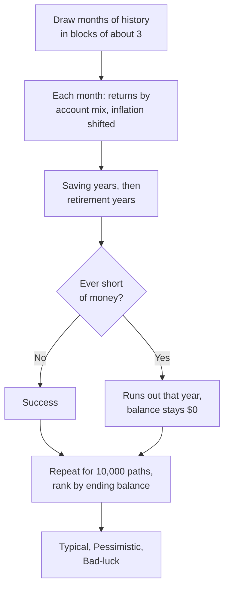

# How the math works: projections

This page explains how RETIVO turns a plan into balances over time and into the
stress-test numbers. It covers the **Planned** and **Historical** projections,
the Monte Carlo stress test and its **Typical**, **Pessimistic** and
**Bad-luck** outcomes, the four market stress tests, spending guardrails and the
safe withdrawal rate comparison. It is for anyone with basic personal-finance
knowledge. You do not need to read code. For each topic it says what the number
means, what goes in, the steps in words, the built-in figures and the dates they
apply to, and what the app simplifies. It is an explanation of the model, not
advice: the results are estimates built from what you entered, and a simulation
is not a forecast.

It leaves out what other pages cover. The yearly withdrawal order and the tax
loop are on the [withdrawals page](math-withdrawals.md). Planned return rates,
asset mix, the allocation glide, contributions and how a past return is measured
from your balance history are on the
[income, expenses and returns page](math-income-expenses-and-returns.md). The
rules the projection applies each year are on the [taxes page](math-taxes.md),
the
[Social Security and health costs page](math-social-security-and-health.md) and
the [retirement accounts page](math-retirement-accounts.md). For where the
controls sit on screen (the **Basis** menu, the five views, the buttons), see
[Reading projections](user-guide.md#reading-projections) in the user guide. For
how the calculation engine fits into the app, see
[architecture.md](architecture.md).

## What each number means

| Name | What it is |
|---|---|
| **Planned** | One line. Every account grows at the return you planned for it, in every year. |
| **Historical** | One line. Every account grows at the yearly rate it actually earned in your balance history. |
| **Monte Carlo** (the stress test) | 10,000 simulated market histories. Each one replays real historical months in a random order and runs your whole plan through them. |
| **Plan success** | The share of those 10,000 paths that never ran out of money. The page shows it as a whole percent. |
| **Typical, Pessimistic, Bad-luck** | Three outcomes picked by ending balance. Typical is the middle path. One path in four ends below Pessimistic, and one in ten ends below Bad-luck. |
| **Example path** | One simulated path chosen to match a tier. It drives the chart line and the yearly tables when you pick that tier as the **Basis**. |
| **Today's dollars, Future dollars** | A display switch. Today's dollars takes inflation out of every amount. Future dollars leaves it in. |
| **Market stress tests** | The same 10,000 paths rerun with one change each: higher fees, lower returns, higher inflation or a longer life. |
| **Spending guardrails** | An optional rule that trims spending after a bad stretch and restores it after a good one, inside every stress-test path. |
| **Safe withdrawal rate** | A comparison of your plan's first full year of withdrawals with the 4% and 4.5% rules of thumb. |

## Planned and Historical

The two projections are the same plan run once each. They differ in one thing:
the yearly growth rate each account gets.

1. **Starting point.** Each account starts from its newest **Account Balances**
   entry, as the
   [income, expenses and returns page](math-income-expenses-and-returns.md#account-growth)
   describes. An account with no entries is left out.
2. **Saving years.** Each month the contribution goes in and the account grows
   at a monthly rate chosen so that twelve months make exactly the yearly rate.
   Contributions stop at each owner's retirement date. The balances at the
   primary member's retirement date start the retirement years.
3. **Retirement years.** From the retirement month, income, spending, taxes and
   withdrawals follow the yearly sequence on the
   [withdrawals page](math-withdrawals.md#how-a-year-runs), with the tax loop
   settling each year's tax. The growth rate still applies to what is left in
   each account.
4. **End.** The projection runs to the last household member's end-of-life year.
   A year in which withdrawals fall short of spending plus tax is the year the
   plan runs out of money.

| | Planned | Historical |
|---|---|---|
| Growth rate of an account | Its **Planning Return %**, or the rate the **Planned returns** card sets for this scenario | The rate measured from its own balance history |
| An account with no measured rate | n/a | Grows at its planned rate |
| A Cash Balance Pension | Its planned rate | Its planned rate |
| When it is offered | Always | When at least one account has a measured rate |

How a past rate is measured, and which accounts have one, is on the
[income, expenses and returns page](math-income-expenses-and-returns.md#measuring-a-past-return).
Under Historical, the page names each account that fell back to its planned
rate. The Historical option is turned off only when no account at all has a
measured rate, because it would then match Planned exactly. If you set an
**Asset allocation** glide, it replaces every account's rate during retirement
under both methods, as
[that page](math-income-expenses-and-returns.md#the-asset-allocation-glide)
explains. A measured past rate is not a forecast: your accounts may earn more or
less than they have.

## Today's dollars and Future dollars

The switch sits in the page header. It starts on Today's dollars and the choice
is remembered in your browser. It changes only what the page shows. The
projection itself is worked out in future dollars, and the switch converts what
is displayed.

- **Planned and Historical.** Today's dollars divides each amount by the
  scenario's inflation rate compounded from the current month to December of the
  amount's year. With no rate set the scenario's inflation is 3%, and at 0%
  nothing changes. Future dollars shows the amounts as projected.
- **Monte Carlo example path.** Today's dollars divides each year by that
  path's own sampled inflation, counted from January of the current year to
  December of that year. A path with high inflation therefore shrinks more. The
  Planned and Historical lines count from the current month instead, so the two
  can differ by up to a year of inflation.
- **Tiers.** The tier cards show a percentile of the ending balances in
  whichever dollars you chose. The example path for each tier is always picked
  by ranking ending balances in today's dollars, whichever way the switch is
  set.
- **Roth conversions card.** Its bars and its total always show the actual
  dollars converted in each year, in future dollars, whichever way the switch
  is set. They are not adjusted for inflation.
- **Safe withdrawal rate lines.** They are built from today's-dollar figures and
  turned back into each year's future dollars when you switch to Future dollars.

## The Monte Carlo stress test

### What goes in

The stress test runs the plan you have today. It uses the same accounts,
contributions, income, spending, Social Security, tax settings and withdrawal
strategy as the other projections. What changes is where returns and inflation
come from. It does not use the planned or the measured growth rate of an
account. It uses each account's stocks, bonds and cash mix and a run of
historical months. The exception is a Cash Balance Pension, which keeps its
fixed planning rate on every path.

### How one path is built

1. **Draw the months.** The path needs one historical month for every month of
   the plan, from January of the current year to the end of the plan. It picks a
   random month from January 1950 to March 2026, then keeps going to the next
   calendar month with a chance of two in three. Otherwise it jumps to a new
   random month. A run of consecutive months is called a block, and blocks
   average 3 months. The end of the data wraps round to January 1950. This is a
   stationary block bootstrap. Because each month is taken whole, stocks, bonds,
   cash and inflation keep the relationship they had in that month, and bad
   stretches cluster the way they do in real markets.
2. **Returns.** Each account's return for a month is its mix applied to that
   month's three returns. A 70% stocks, 25% bonds and 5% cash account in a month
   when stocks fell 4%, bonds rose 1% and cash rose 0.3% earns
   0.70 × −4% + 0.25 × 1% + 0.05 × 0.3% = −2.535%. Every account gets the same
   month, so all accounts feel the same market. The
   [asset mix and glide](math-income-expenses-and-returns.md#asset-mix) set each
   mix over time.
3. **Inflation.** The month's inflation is the historical figure plus a shift.
   The shift is the gap between your scenario's inflation rate and the average
   inflation in the data, spread over twelve months, so a path's inflation
   averages your scenario rate. Returns are not shifted to match.
   - The data averages about 3.5% a year. If your scenario rate is above that,
     real (after-inflation) returns are lower than in history. If it is below,
     they are higher.
   - A category with its own inflation rate, such as Medical, keeps its gap
     above or below the general rate on every path. Medical costs move with the
     same sampled inflation. There is no separate medical-cost surprise.
   - The rough ACA benchmark premium also grows at the scenario's medical
     inflation rate, but at that fixed rate and not at the path's sampled
     inflation, so it is the same on every path.
   - Spending is inflated by each path's own inflation. So is Social Security,
     and so is any income stream set to **Use scenario inflation**. Income with
     a fixed raise does not change from path to path.
4. **Saving years.** Contributions go in until the primary member's retirement
   month, then the plan switches to spending. See
   [simplified or left out](#what-is-simplified-or-left-out) for how this differs
   from Planned.
5. **Retirement years.** Each year follows the same sequence as in Planned, with
   the differences in the [table below](#how-the-stress-test-differs-from-planned-and-historical).
   The main one is that the tax is worked out in two passes with no loop, as
   [The stress test](math-withdrawals.md#the-stress-test) describes. If you turn
   on [spending guardrails](#spending-guardrails), they trim or restore the
   year's spending first.
6. **Running out.** A path runs out in the first year its withdrawals cannot
   cover that year's spending plus the tax on it. From then on its balance is
   held at $0: income that arrives later cannot bring it back.

### Reading the result

- **Plan success** is the paths that never ran out, divided by 10,000. If 9,150
  paths never ran out, success is 91.5% and the card shows 92%. The card
  changes colour at 85% and at 70%.
- **The three tiers** are percentiles of the 10,000 ending balances. Typical is
  the 50th percentile, the balance ranked halfway up. Pessimistic is the 25th
  and Bad-luck the 10th. Each tier's card shows that balance. Beneath it,
  "Runs out" and a year means that by that year this share of all paths had run
  out: half for Typical, a quarter for Pessimistic, a tenth for Bad-luck.
  "Funds the full horizon" means fewer paths than that share ran out.
- **The fan chart.** Its shaded range is different from the example path. For
  each year it takes the 10th, 25th and 50th percentile balance across all
  paths.
- **The example path.** When you pick a tier as the **Basis**, the page shows
  one real path. Its default is the path ranked at that tier. If that path ran
  out (ending below $1 in today's dollars), the page instead picks the run-out
  path whose run-out year is closest to the card's year, so the line and the
  card agree. The page labels it "Based on one example simulated path."
- **Show another likely path.** It swaps the line for another path from the same
  tier. The candidates are paths that still agree with the card: for a tier that
  ran out, a run-out year within 2 years of the card's, and for a tier that did
  not, an ending balance within 2.5% of the tier's. At most 25 paths are kept
  per tier, spread across that range. Each click shows a different one before
  any repeats, and it never returns to the default. The simulation is not rerun,
  so the cards and percentages do not move. The button is off when a tier has no
  alternative. Recalculate or any plan change resets the line to the default.
- **What seeds a run.** A run is deterministic. Its random numbers come from a
  seed worked out from your plan's inputs, so an unchanged plan gives the same
  sample and the same numbers every time. A change to the inputs gives a new
  sample, so a point or so of movement after an edit can be luck of the draw.
- **Recalculate.** It discards the saved result and reruns everything with a new
  sample. The seed moves by a fixed step on each click, so every click gives a
  different sample. The new result replaces the saved one.
- **Sampling error.** Success is an estimate from 10,000 paths. The standard
  error is at most about half a percentage point, so treat a one-point
  difference between two plans as noise.
- **Where it runs.** The paths are worked out in your browser on background
  workers. A 10,000-path run is split across one fewer worker than your device
  has cores, when that is more than one. The answer is the same either way.
  Saved results stay in your browser only.

**Engine version.** The stress-test calculation carries a version number,
currently 72. Each saved result is stamped with the version that produced it.
When the app's version is different, the saved result is discarded and the
stress test runs again.

### The historical market data

The returns and inflation come from two public data sets that are bundled into
the app. They are credited by citation, and the root [NOTICE](../NOTICE) file
lists them.

| Series used | Source | Months in the data |
|---|---|---|
| Stocks (S&P 500 total return), bonds (10-year Treasury total return) and inflation (CPI) | Robert J. Shiller (shillerdata.com; *Irrational Exuberance*) | 1871-02 to 2026-03 |
| Cash (1-month T-bill return) | The Kenneth R. French Data Library, Dartmouth Tuck School of Business (Fama/French) | 1926-07 to 2026-03 |

- **Where sampling starts.** Only months from 1950-01 on are drawn, which is 915
  months through 2026-03. The earlier decades are left out on purpose, because
  the Depression, World War II and Bretton Woods years look unlike the markets
  you will retire into. Through 2026-03 the sample's stocks average about 11.7%
  a year, bonds 5.3%, cash 3.9% and inflation 3.5% (the monthly averages times
  twelve).
- **Monthly-average prices.** Shiller's prices are averages across each month,
  not month-end prices. That smooths month-to-month swings, so the volatility in
  the data is understated by roughly 10-20%. The stress test therefore slightly
  understates downside swings.
- **Fixed data.** The files are updated by hand and nothing in the app downloads
  new data. The newest month in them is March 2026.

### How the stress test differs from Planned and Historical

| | Planned and Historical | Stress test |
|---|---|---|
| Account returns | One fixed rate per account | A sampled month, applied through each account's mix |
| Inflation | The scenario's rate, every year | Sampled for each path, centred on the scenario's rate |
| Tax each year | A loop that settles | Two passes, no loop |
| Tax tables | Scenario inflation | The same, on every path |
| Social Security | Month by month, with the earnings test | Yearly figures, no earnings test, scaled by each path's inflation |
| Working-years Roth conversions | Modelled | Not modelled |
| Spending guardrails | Not applied | Applied when switched on |
| Retirement Fill conversions | Modelled | Modelled, sized again on each path |

The rules behind those rows are on the earlier pages: the
[tax loop](math-withdrawals.md#the-tax-loop), the
[earnings test](math-social-security-and-health.md#the-earnings-test), the
[working-years conversions](math-retirement-accounts.md#working-years-conversions)
and the [Fill conversions](math-withdrawals.md#the-magi-cap).

## The four market stress tests

**Compare against market stresses** on the Overview view reruns the plan four
times, each with one change. Each rerun uses the same seed and the same 10,000
draws as the result on screen, so a difference comes from the change and not
from luck. The first three changes are fixed shifts that never touch the random
numbers. The comparison starts by itself once the stress test has finished, and
it runs again after a plan change or Recalculate. It reports each case's
success, the change from the base run, and the year the median path runs out.

| Stress test | What changes | How |
|---|---|---|
| **Higher fees** | 0.5 percentage points a year come off every account's return | An extra yearly cost only. One-twelfth of it comes off every month. A Cash Balance Pension on its fixed rate is not touched. |
| **Lower returns** | Stocks 2 points lower, bonds and cash 1 point lower each year | Each account loses the mix-weighted share of those cuts. |
| **Higher inflation** | Inflation 2 points higher each year | Added to every path's inflation, spread over twelve months. Returns do not move, so real returns fall. Income that follows inflation rises with it. |
| **Longer life** | Five more years of plan, up to age 105 | The cap is age 105 for the youngest member, so it needs a birthdate. |

A longer life is an estimate rather than an exact rerun. The first part of each
path is identical to the base run. The added years use fresh market months.
Spending repeats the final year's pattern in today's dollars. Social Security
and other income stay at their last dollar amount with no further raise, so they
buy less each year. The plan keeps the filing status and tax return it already
had.

## Spending guardrails

Guardrails are an optional rule for retirement spending. They are off by
default. You turn them on with **Use spending guardrails in this scenario** on
the **Spending guardrails** card. They apply in the stress test only. The
Planned and Historical projections ignore them.

### The scenario card

At the start of each retirement year, on each path, the stress test does this:

1. **Funded ratio.** It divides the portfolio by what the plan still needs.
   - The portfolio is the year's opening balance in today's dollars.
   - The need is each remaining year's planned spending (essential plus
     discretionary) minus guaranteed income. Guaranteed income is Social
     Security, with survivor adjustments, plus lifetime pension annuities.
     Part-time pay, windfalls and lump sums are not counted. A year where
     guaranteed income exceeds spending counts as zero, and does not offset
     another year.
   - Each remaining year's need, in today's dollars, is discounted at 1% a year,
     with the current year undiscounted.
   - The total is divided by 0.85 to allow 15% for tax, because the portfolio
     has to pay the tax as well.
   - The need uses the spending level the guardrail has settled on so far.
2. **Compare with the bands.** At or below the lower band, spending is cut one
   step. At or above the upper band it is raised one step. In between it holds.
   A step is a share of the plan's original spending, so a cut followed by a
   recovery returns to the plan and does not drift.
3. **Limits.** Spending never falls below essential spending plus the
   **Discretionary floor** share of the discretionary spending. It never rises
   above the cap, a percentage of the plan's original spending.
4. **Apply.** All twelve months of the year are scaled by the result. The year's
   tax is then worked out on the adjusted spending, using the same factor in
   both tax passes.

If guaranteed income covers all remaining spending there is nothing to fund. The
ratio is then left undefined and spending holds, still above the floor.

| Setting | Default |
|---|---|
| **Use spending guardrails in this scenario** | Off |
| Lower and upper band | 85% and 115% |
| Step | 10% |
| Increase cap | 100% (never above the plan) |
| Discretionary floor | 50% |

These are fixed rules with no year attached. The 1% rate and the 15% tax
allowance are built in and cannot be edited. When guardrails are on, the page
also reruns the same paths with guardrails off and shows the change in success
beside the success number.

### The Guardrails today screen (beta)

**Guardrails today** is a separate beta screen. It changes nothing in any
projection. It reads your actual balances and describes where your spending
stands today. See [Beta features](user-guide.md#beta-features) for when it
appears.

- **Who it is for.** Scenarios whose retirement month has arrived or passed.
  Before that it shows a message instead.
- **Settings.** The scenario's own guardrail settings, or the defaults when it
  has none. The screen says which.
- **Funded ratio today.** The same arithmetic as above, with today's balances in
  the active accounts and no path inflation. The current year's need is cut to
  the part of the year still left.
- **Range position.** It says whether the ratio is below, within or above the
  selected range, or that guaranteed income covers your spending. It is a
  description. It does not apply a step.
- **Check now.** It runs a fresh 10,000-path stress test from today's balances,
  with your real settings and a fixed seed. No saved result is read or written,
  and the run stops after 20 seconds. If the ratio is above the range but the
  success rate is below 80%, a note says so. The range position itself does not
  change.

## Safe withdrawal rate comparison

The **Safe withdrawal rate** view compares your plan with two rules of thumb
from published research on how much a portfolio can pay out each year. They are
not forecasts. The rule lines are the **4% rule** and the **4.5% rule**.

1. **Portfolio at retirement,** in today's dollars. It is the total of every
   account's balance at the retirement month under the active basis. Cash
   Balance Pension accounts that pay an annuity, or that were taken as a lump
   sum before retirement, are left out. Under a Monte Carlo tier it is the
   example path's own balance at the last December before it retires.
2. **Rule spending.** The rate times that portfolio. It is held level in today's
   dollars in every later year. There is no inflation step. Switching to Future
   dollars only shows the same real figure in each year's dollars.
3. **Your draw.** The plan's gross withdrawal from the portfolio in the first
   full calendar year of retirement, minus that year's federal tax and Medicare
   surcharge. The ACA credit is already in that tax figure, and the part of it
   that lowers withdrawals already lowers the withdrawal. That is the retirement
   year itself when retirement is January 1, and the next year otherwise. Spending paid by Social
   Security, pensions and other income is not in it.
4. **The difference.** The screen shows how far your draw is above or below each
   rule's amount.

The published rates are stated on the whole withdrawal including its tax, and
the page compares them with the part left after tax. A plan can show under a
rule line while its total withdrawal is at or above that rate. The comparison is
not shown when there is no retirement age, when the retirement date has already
passed, when there is no full retirement year in the plan, or when the active
basis has no result.

## Built-in figures and years

The market data is the only part of this page tied to dates. Everything else is
a fixed rule with no year, and none of it changes with the year.

| Figure | Value | Kind |
|---|---|---|
| Paths in a run | 10,000 | Fixed rule |
| Step | One month | Fixed rule |
| Average block length | 3 months | Fixed rule |
| Sampled months | 1950-01 to 2026-03 (915 months) | Dated data |
| Shiller series | 1871-02 to 2026-03 | Dated data |
| French T-bill series | 1926-07 to 2026-03 | Dated data |
| Average inflation in the sample | About 3.5% a year | Dated data |
| Tier ranks | 50th, 25th and 10th percentile | Fixed rule |
| Ran out | A year that falls short of spending plus tax | Fixed rule |
| Example path counted as ended at $0 | Ending below $1 in today's dollars | Fixed rule |
| Alternative example paths | At most 25 a tier; 2 years or 2.5% of the card | Fixed rule |
| Success card colour changes | At 85% and 70% | Fixed rule |
| Higher fees | 0.5 points a year | Fixed rule |
| Lower returns | Stocks 2, bonds 1, cash 1 point a year | Fixed rule |
| Higher inflation | 2 points a year | Fixed rule |
| Longer life | 5 years, up to age 105 | Fixed rule |
| Guardrail bands, step, cap, floor | 85% and 115%, 10%, 100%, 50% | Default of a setting |
| Guardrail discount rate and tax allowance | 1% and 15% | Fixed rule |
| Guardrails today check | 20 seconds; success flag below 80% | Fixed rule |
| Safe withdrawal rates | 4% and 4.5% | Fixed rule |
| Engine version | 73 | Fixed rule |

## What is simplified or left out

Only items that change a number are listed.

- **History starts in 1950.** Anything outside the sample, including a crisis
  unlike any in it, cannot appear. The data ends in March 2026.
- **Three asset classes only.** Stocks are the S&P 500, bonds the 10-year
  Treasury and cash the 1-month T-bill. Every account's mix is made of those
  three.
- **Smoothed volatility.** The monthly-average prices understate swings by
  roughly 10-20%.
- **One market for everyone.** All accounts share each month's returns.
- **Inflation is centred on your rate, returns are not.** A scenario rate far
  from the data's 3.5% moves real returns away from history.
- **Medical costs have no surprise of their own.**
- **Two-pass tax.** The stress test taxes each path in two passes, with no loop.
  Its tax tables use the scenario's inflation rate, not the path's.
- **No earnings test, and a simpler Social Security.** See the
  [Social Security page](math-social-security-and-health.md#the-earnings-test).
- **No working-years Roth conversions.** Planned and Historical model them. The
  stress test does not. See the
  [retirement accounts page](math-retirement-accounts.md#working-years-conversions).
- **Saving-year contributions are simpler.** Every account keeps contributing
  until the primary member's retirement month, even if its owner retires
  earlier. Only the planned amounts go in. Company contributions recorded on
  **Account Balances** are not added in those years. A later-retiring owner's
  deposits after the primary retires follow the
  [contributions page rules](math-income-expenses-and-returns.md#contributions).
- **A longer life is padded.** See
  [the stress tests](#the-four-market-stress-tests).
- **Guardrails measure need roughly.** The 1% rate and the 15% tax allowance are
  fixed. Only Social Security and lifetime annuities count as guaranteed income.
- **Safe withdrawal rate compares after tax.** The published rules do not.
- **Historical repeats the past.** It assumes each account keeps its measured
  average rate in every year.
- **Active accounts only.** An inactive account is not in any projection.
- **Sampling error.** Up to about half a percentage point on success.

## Worked example

**The safe withdrawal rate.** Jo retires with $1,000,000 in the portfolio. The
4% rule gives $40,000 a year, and the 4.5% rule $45,000. Jo's plan draws $42,000
after tax in the first full year. That is $2,000 above the 4% line and $3,000
below the 4.5% line.

**One guardrail year at a time.** Jo is retired and has turned on spending
guardrails with the defaults. Jo's plan spends $80,000 a year in today's
dollars, $40,000 of it essential. Social Security and a pension pay $40,000, so
the plan needs $40,000 a year from the portfolio for the next 30 years. Every
figure is in today's dollars.

1. **Year 1.** The portfolio opens at $1,250,000. The 30 years of need, with the
   first year undiscounted and later years discounted at 1%, are worth
   $1,042,631. Divided by 0.85 that is $1,226,625. The funded ratio is
   $1,250,000 ÷ $1,226,625 = 101.9%. That is between 85% and 115%, so spending
   holds at $80,000.
2. **Year 2.** A bad year leaves $1,000,000. Now 29 years remain, worth
   $1,012,658, or $1,191,362 after the 15% allowance. The ratio is 83.9%, below
   85%, so spending is cut one step. A step is 10% of $80,000, so spending falls
   to $72,000.
3. **The floor.** The lowest spending can go is $60,000: the $40,000 of
   essentials plus 50% of the $40,000 of discretionary spending. The $72,000
   sits above it.
4. **Year 3.** Growth in year 2 about offsets Jo's withdrawals, so the portfolio
   opens at $1,000,000 again. The need is now $72,000 − $40,000 = $32,000 for
   28 years, worth $785,907, or $924,597 after the allowance. The ratio is
   108.2%, inside the bands, so spending holds at $72,000. It would be raised
   one step only if the ratio reached 115%, which needs a portfolio of about
   $1,063,000.

## Where the code lives

All paths are under `apps/web/src`.

| File | What it does |
|---|---|
| `lib/projection-method-labels.ts` | The names Planned and Historical. |
| `lib/balance-projection-runner-projection.ts` | Each account's rate under each method, the fallback and whether Historical is offered. |
| `lib/view-deflator.ts`, `pages/balance-projection-view-derivation.ts`, `pages/use-balance-projection-view-model.ts` | The Today's and Future dollars switch, and the example path's own deflator. |
| `lib/monte-carlo.ts` | One path's run, the two tax passes, the engine version and each path's seed. |
| `lib/monte-carlo-step-inputs.ts` | Drawing the months, the inflation shift, and each path's spending and income. |
| `lib/projection-engine/historical.ts` | Loading the data and the block sampler. |
| `lib/historical-data/` | The two data files. |
| `lib/monte-carlo-per-account.ts` | Each account's monthly return, the fee and return shifts, and path-scaled contributions. |
| `lib/balance-projection-bundle.ts`, `lib/balance-projection-bundle-mc-ledger.ts`, `lib/monte-carlo-input-bundle.ts` | Building the stress test's inputs, including saving-year contributions and the guardrail need. |
| `lib/monte-carlo-scenario-input.ts` | The 10,000-path count. |
| `lib/monte-carlo-shard.ts`, `monte-carlo/` | Counting successes, and splitting a run across workers. |
| `lib/monte-carlo-summary.ts` | Percentiles, the tiers, the example path and the alternatives. |
| `lib/monte-carlo-input-signature.ts` | The plan's content signature and the seed an automatic run draws from it. |
| `components/PlanStressTestSection.tsx` | Using that seed, and Recalculate. |
| `lib/success-delta-noise.ts` | The noise check on a difference between two success probabilities. |
| `pages/balance-projection-compare-data.ts`, `lib/signed-difference.ts`, `lib/scenario-change-list.ts`, `lib/structural-equality.ts` | The figures two scenarios are compared on, how a difference reads, the list of settings that changed, and the identical-results check. |
| `db/monte-carlo-cache.ts` | Saved results, checked against the engine version, and a read that leaves them untouched. |
| `assistant/tools/stress-test.ts` | The AI assistant's stress test: the saved result if there is one, otherwise the page's 10,000 paths and seed, run in the open tab and saved nowhere. |
| `lib/market-stress.ts`, `components/plan-market-stress-comparison.ts` | The four stress tests and their comparison. |
| `lib/guardrails.ts`, `lib/drawdown-engine-per-account-strategy.ts` | The funded ratio and the yearly guardrail step. |
| `pages/GuardrailsPage.tsx`, `pages/use-guardrails-vm.ts` | The Guardrails today screen. |
| `lib/safe-withdrawal-rate.ts`, `pages/balance-projection-swr-derivation.ts` | The rule amounts and the comparison. |
| `lib/balance-projection-runner-drawdown.ts` | The portfolio at retirement behind the comparison. |
| `components/MonteCarloMethodologyModal.tsx` | The on-screen explainer behind the **(i)** next to **Success probability**. |
