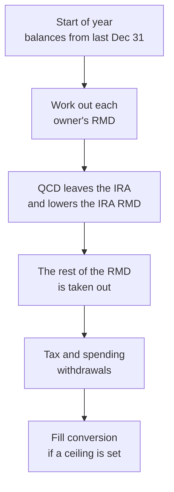

# How the math works: retirement accounts

This page explains how RETIVO applies the rules that sit on top of retirement
accounts: required minimum distributions (RMDs), charitable distributions from
an IRA (QCDs), Roth conversions, the order money leaves a Roth account, and the
break-even comparison on the **Roth conversion comparison** page. It is for
anyone with basic personal-finance knowledge. You do not need to read code. For
each topic it says what the number means, what goes in, the steps in words,
which built-in figures are used and for which years, what the app simplifies,
and where the code lives. It is an explanation of the model, not tax advice: the
figures are estimates built from what you entered, and the built-in tables are
a snapshot that may be out of date.

Brackets, the two MAGI income measures, the 10% early-withdrawal penalty and
penalty exemptions, and how tax tables carry past their last year are on
[the taxes page](math-taxes.md). This page uses them and does not work them out
again. IRMAA and the ACA premium credit are on the
[Social Security and health costs page](math-social-security-and-health.md);
here they appear only as part of the cost of a conversion. How withdrawals cover
an RMD, which accounts are drawn first and how an income ceiling limits
withdrawals are covered on the withdrawals page. For where these settings are on
screen, see the user guide sections [Accounts](user-guide.md#accounts),
[What the cards do](user-guide.md#inside-a-scenario) and
[Roth conversion comparison](user-guide.md#roth-conversion-comparison). For how
the calculation engine fits into the app, see [architecture.md](architecture.md).

## Which rule touches which account

| Account type | RMD | QCD | Roth conversion | Roth withdrawal rules |
|---|---|---|---|---|
| Traditional IRA | Yes | The source of a QCD | A source | n/a |
| 401(k), 403(b), 457(b), TSP | Yes, for the pre-tax part (the Roth part of a Mixed account is left out) | No | A source for the pre-tax part. A Mixed account's own Roth side can receive an in-plan conversion | The Roth side of a Mixed account follows the Roth 401(k) rules |
| Cash Balance Pension | Yes (and a rolled lump sum can carry one) | No | Not a working-years source | n/a |
| Roth IRA | None for you | No | The target | Order and five-year clock |
| Roth 401(k), Roth 403(b), Roth 457(b), Roth TSP | None for you | No | Not a target | Each account on its own |
| Other | None | No | A working-years source when set to pre-tax or Mixed | n/a |
| HSA, Brokerage, Savings, Money Market, CD | None | No | No | n/a |

An account you **inherited** follows the beneficiary rules in the RMD section
instead, whatever its type. That includes an inherited Roth account. An
inherited HSA or non-retirement account owes none.

## How a year runs

In each retirement year the order is:

Working-years conversions happen earlier, in January of each year you are still
working.

## Required minimum distributions (RMDs)

An **RMD** (required minimum distribution) is the minimum the IRS makes you
withdraw each year from tax-deferred retirement accounts once you reach a set
age. RETIVO works out the amount here. The amount is taxable income (see the
taxes page).

### What goes in

- **Your birth date.** Age is your age at the end of the tax year, which is the
  year minus your birth year. There is no half-year rule for RMDs.
- **Each account's balance on Dec 31 of the year before.** In the first
  retirement year, the balance at the retirement date stands in for it.
- **Each account's type and tax treatment**, from the table above, and the Roth
  part of a Mixed account.
- **Your retirement year**, from the household, for the still-working rule.
- **Facts on the account**, in its **Advanced tax details** section: **I
  inherited this account** and the questions that follow it, **This is my
  current employer's plan** and its two follow-up questions, **Postpone my first
  required withdrawal to April 1 of the next year**, and **My spouse is the only
  beneficiary of this account**. A question you leave unanswered does not turn
  on the favourable rule: no postponement, and no joint table.

### Who owes one, and from what age

You owe an RMD for each year in which your age is at or above your **trigger
age**:

- **73** if you were born from 1951 to 1959.
- **75** if you were born in 1960 or later.
- Anyone born in 1950 or earlier also uses 73. They are already past it in every
  year the app models.

These ages are fixed rules, not yearly figures. Each person is worked out
separately for the accounts they own. An inherited account is never held back
by the beneficiary's own trigger age.

### How the amount is worked out

1. **Find your age** at the end of the tax year. Below your trigger age you owe
   no RMD from your own accounts.
2. **Find each account's base.** It is the Dec 31 balance of the year before,
   less its Roth-designated part. Only the pre-tax part of a Mixed 401(k),
   403(b), 457(b) or TSP counts. Roth IRAs and Roth employer accounts carry no
   RMD for you.
3. **Pick the divisor** from the life-expectancy table for your age (next
   section). An age above 120 uses the entry for 120.
4. **Divide.** Add up the bases of the accounts that share a divisor, divide by
   it, and round to the cent.
5. **Split it across the accounts** in proportion to their bases, in whole cents
   that add back to the total exactly.

**Aggregation groups.** The IRS lets you take the IRA minimum from any of your
IRAs, and the 403(b) minimum from any of your 403(b)s. Every other employer plan
must satisfy its own. The **Projected withdrawals** page shows the RMD grouped
this way. The groups are a display. They do not change the amount. An inherited
account is never grouped with your own.

### Which life-expectancy table

| Table | Used for | Divisor looked up by |
|---|---|---|
| **Uniform Lifetime** (Table III) | You, for your own accounts. This is the default. | Your age. Age 73 gives 26.5, 75 gives 24.6, 80 gives 20.2 |
| **Joint Life and Last Survivor** (Table II) | You, when your spouse is the only beneficiary of the account and more than 10 years younger | Your age and your spouse's age |
| **Single Life** (Table I) | A beneficiary taking a stretch from an inherited account | The beneficiary's age |

The Table II switch is checked against both birth dates. A spouse born exactly 10
years later does not qualify, and without both dates the account's RMD is held
back (see *Missing facts*).

The tables are from IRS Publication 590-B, Appendix B, in effect since
January 1, 2022. They are stored once, under the year 2024. Every later year
uses the same tables, with no inflation scaling.

### Special cases

- **Still working.** The RMD from an employer plan (401(k), 403(b), 457(b), TSP
  or Cash Balance Pension, never an IRA) is put off while you still work for
  that employer. All three must be answered in your favour: it is your current
  employer's plan, you do not own more than 5% of the employer, and the plan
  does not require withdrawals at that age anyway. The plan then has no RMD in
  any year before your retirement year. From the retirement year on, it owes
  the ordinary amount. With no retirement year on file, the postponement is not
  applied.
- **First-year postponement.** In the first year you owe an RMD you may delay it
  to April 1 of the next year. RETIVO takes that amount out of the first year
  and adds it to the next year's own RMD, so **two RMDs land in one year**. The
  postponed amount is sized from the first year's own balance and divisor. With
  the still-working rule, the first RMD year is the **later** of the trigger-age
  year and your retirement year. Postponement is only for your own accounts, not
  inherited ones.
- **Roth-designated money.** It has no RMD for you: Roth IRAs, Roth 401(k),
  Roth 403(b), Roth 457(b), Roth TSP, and the Roth part of a Mixed account.
- **A Cash Balance Pension lump sum.** If a lump sum is rolled over in or after
  your trigger-age year, that year's RMD is worked out on the rolled balance
  with the Uniform Lifetime table and paid out as taxable income first. Only the
  rest rolls over.
- **Inherited accounts.** The rule depends on who you are to the original owner,
  the owner's death date, and whether the owner died before or on/after their
  **RMD start date** (April 1 after the year they reached their RMD age: 70½ if
  born before 1950, 72 if born in 1950, 73 if born 1951 to 1959, 75 if born 1960
  or later). An inherited Roth account is always treated as a death before the
  RMD start date, because a Roth owner never has one.
  - **Spouse, the owner's child under 21, a disabled or chronically ill person,
    or a person not more than 10 years younger** can spread withdrawals over
    their life expectancy (Single Life table) or choose the 10-year rule. If the
    owner died on or after their RMD start date, the 10-year choice does not
    exist: the stretch is required.
  - **A spouse** looks the divisor up again each year from their current age.
    If the owner died before their RMD start date, no RMD is due until the
    year the owner would have reached that same RMD age. The app uses the whole
    year, so 70 stands in for 70½.
  - **The others** fix the divisor from their age in the year after the death
    and lower it by 1.0 each later year. An owner's child follows this until the
    year they turn 21, and then the 10-year rule starts in that year.
  - **When the owner died on or after the RMD start date**, a stretch uses the
    longer of two life expectancies: the beneficiary's own and what the owner
    had left.
  - **Anyone else** (another named person) follows the 10-year rule. **An
    estate, charity or trust** follows the 5-year rule if the owner died before
    the RMD start date.
  - **The 10-year rule** says the account must be empty by the end of the 10th
    year after the window starts (the death year, or the year an owner's child
    turns 21). A yearly minimum applies only in years 1 to 9, and only if the
    owner died on or after the RMD start date. In every other year it is $0.
  - **The 5-year rule** sets a deadline, not a yearly amount, and a spouse's
    delayed start has no amount until it begins, so both show $0. RETIVO does
    not force an account empty at a deadline. It takes only the yearly minimums.
  - **The death year itself** is still the owner's own final RMD, not a
    beneficiary year.
  - **Not modeled:** a death before 2020, and an estate or charity when the owner
    died on or after the RMD start date. Both are held back and reported.

### Missing facts

When a rule needs a fact the account does not have, RETIVO does not guess. It
leaves that account's RMD out of the year, so it counts as $0, and reports it
on the **Projected withdrawals** page: no required withdrawal is included for
that account because the details are not all available. For example, an
inherited account with only your relationship to the owner on file is held back
until the death date and the owner's RMD start date status are given. The same
happens to a postponement on a still-working plan when your retirement year is
unknown, to a Table II switch when a birth date is missing, and to a postponed
first-year amount when the earlier balance is not available.

### Simplified or left out

- **First retirement year.** The balance at the retirement date stands in for
  the prior Dec 31 balance, so that year's RMD can be a little off.
- **No penalty for a missed RMD.** The app charges no excise tax. A shortfall
  is shown on the RMD band of the **Taxes & distributions** view instead.
- **A Cash Balance Pension** is treated like an account balance divided by the
  Uniform Lifetime divisor. A plan that pays by annuity rules would differ.

**Code.** Paths are under `apps/web/src`. `lib/rmd.ts` has the trigger ages,
the rules above and the amount. `lib/rmd-divisors.ts` has Table III.
`lib/rmd-life-expectancy-tables.ts` has Tables I and II and picks the divisor.
`lib/rmd-allocation.ts` splits the amount across accounts.
`lib/rmd-aggregation-groups.ts` builds the display groups.
`lib/rmd-rollover-split.ts` carves out the rollover-year RMD.
`lib/tax-integration.ts` and `lib/drawdown-engine-per-account-qcd-hsa.ts` call
it for the year's tax and its forced withdrawal.
`pages/account-tax-profile-section.tsx` is the **Advanced tax details** section.

## Charitable distributions (QCDs)

A **QCD** (qualified charitable distribution) is a gift sent straight from a
traditional IRA to a charity once you are 70½ or older. It is left out of your
income. It also counts toward your RMD.

### What goes in

Each entry on the **Charitable distributions (QCDs)** card of a scenario has:

- the person giving, and the source account. It must be that person's own
  traditional IRA set to pre-tax;
- a yearly amount **in today's dollars**;
- a start and an end, as years or ages (**Give starting**, **Give through**).

### How it is worked out

1. **Find the start year.** It is the calendar year that contains the date 70
   years and 6 months after your birth. Born January 15, 1954, you turn 70½ on
   July 15, 2024, so the year is 2024. Born July 1, 1954, you turn 70½ on
   January 1, 2025, so it is 2025. This is a precise half-year, unlike the
   year-end age used elsewhere. The 70½ age is a fixed rule. It does not depend
   on your RMD age, so someone aged 70½ to 72 can give with no RMD yet. An entry
   that starts earlier is moved up to this year.
2. **Grow the amount.** The entered amount is grown with inflation to that
   year's dollars. In the stress test each path uses its own inflation.
3. **Cap each entry** at the smallest of three amounts:
   - the grown amount;
   - what is left of that person's yearly limit. One limit is shared by all of
     that person's entries, used in order of start year;
   - the source IRA's pre-tax balance, after any earlier entries that year from
     the same IRA.
4. **Take it out.** The gift leaves the IRA's pre-tax balance. It is not
   spending money.
5. **Offset the RMD.** The QCD counts toward that person's **IRA** RMD, up to
   the size of that RMD. It never counts toward a 401(k), 457(b), TSP or Cash
   Balance Pension RMD. Below RMD age the offset is $0. A gift larger than the
   IRA RMD is still a gift, but it offsets no more.
6. **Keep it out of income.** The whole QCD, not just the part that offsets the
   RMD, is left out of income and out of both MAGI measures. See
   [the two income measures](math-taxes.md#the-two-income-measures-magi).

The yearly limit is in the table of built-in figures below. QCDs run in the
Planned, Historical and stress-test projections.

### Simplified or left out

- Each entry is a fixed yearly amount. There is no one-time gift and no gift
  sized as a share of the RMD.
- The limit is applied to each person on their own.
- For years past 2026 the limit grows at the scenario's general inflation
  rate, the same rate for every stress-test path.

**Code.** Paths are under `apps/web/src`. `lib/qcd.ts` has the start year, the
caps and the offset. `lib/qcd-limits.ts` has the yearly limits.
`lib/qcd-window.ts` turns the start and end into years.
`lib/scenario-resolution.ts` drops entries that cannot apply.
`lib/drawdown-engine-per-account-qcd-hsa.ts` runs the gift each year.

## Roth conversions

A **Roth conversion** moves money from a pre-tax account to a Roth account. The
amount counts as ordinary income in the year it moves. After that it can come
out tax-free if the Roth rules below are met. RETIVO models two kinds.

### Working-years conversions

This is the **Pre-retirement Roth conversions** card, headed "Roth conversions
while working".

**What goes in.** For each conversion: a source, a target, a flat yearly amount,
a start and an end (**Convert starting**, **Convert through**), and one **Assumed
tax rate on converted money** for the whole card.

- The **source** is one of your active accounts, pre-tax or Mixed, but not a
  Cash Balance Pension. A Mixed account converts only its pre-tax part.
- The **target** is the same person's own Roth IRA, never an inherited one. It
  can also be the same Mixed 401(k), 403(b), 457(b) or TSP account, which moves
  money from its pre-tax side to its own Roth side.

**How it is worked out.**

1. **Pick the years.** A conversion runs in each year of its window that is this
   year or later, before the source owner retires, and before the year they
   reach their RMD trigger age. RMD dollars cannot be converted.
2. **Take the amount as typed.** It is a flat amount with no inflation growth.
3. **Cap it** at the source's pre-tax balance just before the move, after any
   other conversion from the same account that year.
4. **Move it in January.** The amount leaves the source and enters the target in
   January of the year.
5. **Record it.** Converted money is recorded as a conversion in that year. It
   starts its own five-year clock (see the Roth withdrawal rules below). An
   in-plan conversion is recorded as an in-plan rollover in the same way.

**Where the tax comes from.** The tax is **shown, not paid**. The assumed rate
times the converted amount appears on the card and its summary, and the report
lists the rate. It is not taken out of any balance and is not used anywhere else
in the projection. The model assumes you pay it from your working income,
outside the accounts it projects. These conversions are modeled only in the
Planned and Historical projections, not in the stress test.

### Retirement "Fill" conversions

A Fill conversion uses room under an income ceiling to convert pre-tax money to
a Roth in retirement. It runs only while a ceiling is active, in the **Fill the
cheap tax room with Roth conversions** mode, with a target Roth IRA.

**What goes in.** A MAGI cap schedule on the scenario's **Withdrawal strategy**
card. Each window has a yearly ceiling, a choice of which income line the
ceiling is measured on (**Medicare (IRMAA) income** or **ACA marketplace
income**, the two measures on
[the taxes page](math-taxes.md#the-two-income-measures-magi)), a mode, and a
target Roth IRA. The target must be your own Roth IRA, not an inherited one. The
ceiling limits the year's pre-tax income, which is withdrawals plus conversions.
In the other mode, **Keep my income low**, withdrawals come from already-taxed
money first and nothing is converted. The withdrawals page covers how the
ceiling steers withdrawals.

**How it is worked out.** Once a year, after that year's withdrawals:

1. **Find the room.** It is the ceiling less the pre-tax income already drawn
   (the RMD and the withdrawals for spending and tax).
2. **Size the conversion.** The model tries amounts up to the room and reruns
   the full tax calculation each time. It keeps the largest amount that leaves
   MAGI on the chosen line at or below the ceiling, rounded down to the cent.
   Trying amounts is needed because a converted dollar can pull more Social
   Security into taxable income, so it can raise MAGI by more than a dollar.
3. **Move it.** The amount leaves your pre-tax balances, account by account,
   and enters the target. A Mixed account gives up only its pre-tax part.
4. **Pay the tax.** The extra tax the conversion causes that year is paid only
   from money that does not raise MAGI: Roth balances, Savings, Money Market,
   CD and HSA balances, and the Roth side of a Mixed account. It honours any
   minimum balance you set. The target Roth is used last, and only down to the
   balance it had before the conversion. Brokerage and pre-tax money are not
   used, because that would push MAGI above the ceiling. Tax that this money
   cannot cover makes that year count as running short of money. The higher
   income also raises the Medicare surcharge two years later, and that surcharge
   is paid in the later year as usual.
5. **No penalty.** The converted amount is ordinary income, but it is not a
   withdrawal, so no early-withdrawal penalty applies.

No conversion happens in a year when the RMD alone, or the withdrawals, already
reach the ceiling, or when no window covers the year. With no valid target Roth
IRA, Fill only limits withdrawals, and the scenario shows a notice. Fill
conversions also run in the stress test, with the same sizing on each path.

### Comparing conversion plans

The **Compare conversion plans** panel on the Roth conversion comparison page
tries a fixed set of Fill plans for the selected scenario and ranks them by what
is left at the end. Running it only reads your data and saves nothing. A ranked
plan is written to the scenario only when you press **Save plan to scenario** on
its row and confirm (see **Saving a plan** below).

**What goes in.** The same accounts, balances, members, Social Security,
expenses and income the page's own planned projection uses, today's date, and
three more things.

- A **target Roth IRA**: an active Roth IRA of your own, never an inherited one.
  The panel uses the first one on the page's list and names it.
- The **leftover-tax rate**, an input on the page. It starts at the average
  marginal rate the break-even uses for the years when required withdrawals
  begin, rounded to a whole percent, and is 22% when there are no such years.
- An **assumed death age** for each household member: the scenario's
  life-expectancy setting, or 95 where it sets none for the primary member. A
  partner age the scenario does not set is left unset, so the comparison reads
  it exactly as the page's own projection does.

A scenario that files married filing separately is left out, because the ACA
premium credit is never available on separate returns.

**How it is worked out.**

1. **Find the window.** It runs from the primary member's retirement year (or
   this year, if later) through the year before they reach their RMD trigger age,
   cut off at the end of the projection. With no such year there is nothing to
   compare.
2. **List the plans.** The current plan, as the scenario has it, plus four
   target brackets (12%, 22%, 24% and 32%) each with and without the cliff
   guards: nine plans.
3. **Set a ceiling for each year.** A plan's ceiling for a window year is the
   smallest of up to three limits, all measured on the MAGI line the Fill
   ceiling uses.
   - *Bracket top.* The floor of the next bracket up, plus the year's standard
     deduction, the extra deduction for each member who turns 65 by year end and
     the senior bonus deduction where it applies. The senior bonus shrinks as
     income rises, so it is worked out at the ceiling itself.
   - *Medicare surcharge line* (guarded plans only). A year's income sets the
     surcharge two years later, so this is the next surcharge line above the tier
     the scenario sits in that later year in the baseline projection (described
     below). Under every line, that is the first line. It applies when someone is on Medicare then.
   - *Premium credit line* (guarded plans only). Four times the poverty
     guideline for the household less the Social Security that is not taxable,
     because the ACA income adds that back. It applies in years with Marketplace
     coverage while the credit has a cliff at that line, and only where the
     baseline projection is not already over it.

   Both guards are held against the baseline projection, not against the current
   plan. The baseline is the scenario projected with no MAGI cap windows at all:
   no Fill conversions, and no Minimize caps limiting pre-tax withdrawals either.
   The current plan stands in for it only when the scenario has no cap windows of
   any mode. With cap windows, whether Fill or Minimize, the current plan's own
   conversions or capped withdrawals may already move a year's income into a
   different surcharge tier or across the credit cliff, so the current plan
   cannot be the reference. A Fill window with no valid target Roth converts
   nothing but is still a cap window, so it also rules the current plan out. A
   guarded plan is therefore held to stay under the line that the baseline stays
   under: it never takes a year into a higher surcharge tier, or over the credit
   cliff, than it would be in with no cap windows. For example, if the current
   plan puts a year's income in surcharge tier 1 but the baseline is under every
   line, a guarded plan is held under the first line, not the tier 2 line. If the
   baseline is under the credit cliff, the guard applies even where the current
   plan is over it. A plan that still
   crosses a line it is held to is flagged in step 6.

   The Fill step cannot see the interest and dividends that taxable accounts
   throw off while it sizes a conversion, so the ceiling is the limit less that
   gap, measured from the previous projection.
4. **Project and settle.** Each plan is projected with one Fill window per year
   at its ceilings. The ceilings are then worked out again from the new
   projection, and this repeats until no ceiling moves by more than a dollar, at
   most ten projections per plan. Each year is filled on its own, with no
   look-ahead to later years.
5. **Rank.** The score is the **after-tax ending balance**:

   *ending balance in today's dollars − pre-tax and mixed balances left in
   today's dollars × leftover-tax rate.*

   Roth, brokerage and cash balances count in full. Ties go to fewer dollars
   converted, then the lower bracket, then the order above. Totals shown beside
   the score (converted, income tax, Medicare surcharges, premium credit) are
   each year's figure brought to today's dollars with that year's December
   deflator, so they share a basis with the ending balance. Changing the rate
   re-ranks from the stored balances without projecting again.
6. **Flag.** A plan whose cap could not be kept (the engine had no taxable money
   left to move spending to, an RMD alone sat above the ceiling, income stayed
   above the bracket top, or a guarded plan still crossed its line) is shown but
   not ranked. A plan in which the
   ceiling moved spending withdrawals to a later taxable account is ranked and
   marked, because part of its result is a change in withdrawal order.

The search runs at most 500 projections and stops with an error beyond that;
nine plans at ten projections each stay far below it.

**Simplified or left out.**

- **One death age.** Every plan is scored at the assumed death ages. It is not a
  forecast and not the stress test; no Monte Carlo runs.
- **Planned basis, federal tax only.** No state tax, and the IRA pro-rata rule is
  not modeled.
- **A fixed set of targets.** Four brackets, guarded or not, held for the whole
  window. The top row is the highest score among them, not a proven optimum.
- **Capital gains and qualified dividends** are not counted in the bracket top,
  so the ceiling is a little conservative.
- **One flat leftover-tax rate** for everything still in pre-tax accounts.
- It shows what each plan does in this model and does not say which to pick.

**Saving a plan.** **Save plan to scenario** turns a ranked row into the
scenario's cap schedule on its **Withdrawal strategy** card, so the projection
and the Fill conversions described above then run it. It is offered on ranked
rows only, not on the current plan and not on a plan whose cap could not be kept.
What is written:

- *One window per year.* Each year of the plan's window gets its own Fill window,
  with the same year as its start and its end, so adjacent windows do not overlap.
  The windows are anchored to calendar years, not to ages, so they stay put if
  you later change a retirement or birth year. They are saved in ascending year
  order, one per year.
- *Whole-dollar ceilings.* Each ceiling is the figure the search settled on for
  that year, rounded down to a whole dollar (never below zero), so a saved
  ceiling is never above the one the row was ranked on. It is a fixed amount in
  that year's own dollars: it does not rise with inflation.
- *The Medicare (IRMAA) income line.* Every window is measured on that line,
  the line the comparison sized its ceilings on, with Fill mode and the target
  Roth IRA the comparison used. Dropping either would convert different amounts
  than the row showed, so you cannot pick another target in the dialog.
- *Everything else is replaced.* Every cap window the scenario had is replaced by
  the plan's windows. Nothing else on the scenario changes. A scenario that
  inherits its cap from a parent and saves a plan equal to the parent's goes on
  inheriting; any other plan is saved on that scenario only and the parent is
  untouched.

A window caps pre-tax income, as in the Fill description above; it does not order
a conversion. In a year when spending needs more pre-tax money than the ceiling
leaves, the projection draws on taxable or Roth accounts, and records that the
cap could not be met when none are left. The ceilings were worked out against
the data as it stood, so they are a snapshot: the page marks a saved plan **Out
of date** once an account, balance, member, expense, income, Social Security or
scenario setting it used has changed, and the comparison has to be run again to
refresh it.

**Code.** Paths are under `apps/web/src`. `lib/roth-suggestion/search.ts` runs
the search; `candidate-grid.ts` lists the plans, `year-limits.ts` works out the
three limits, `candidate-passes.ts` is the settle loop, `summarise.ts` and
`ranking.ts` score and rank. `workers/roth-suggestion.worker.ts` runs it in the
background and `pages/roth-betr/RothSuggestionPanel.tsx` shows it.
`year-detail.ts` builds each plan's year-by-year table and
`pages/roth-betr/RothSuggestionYearDetail.tsx` shows it. `lib/roth-suggestion/ladder.ts`
makes the one-year windows, `lib/roth-betr-apply-helpers.ts`
(`buildSuggestionCap`) fixes the saved shape, and
`pages/roth-betr/use-roth-suggestion-save.ts` writes it through the page's save
path.

#### Why each year

The **Why each year** button on a row opens a table with one line per year of the
window, then the year after it, for that plan. It uses each year's own (future)
dollars, because the limits and cliffs are fixed amounts for the year; the
comparison above is in today's dollars. The columns are:

- *Converted*, and *Stopped by*: the bracket top, the Medicare surcharge line,
  the health-subsidy line, the end of the window, withdrawals that had already
  reached the ceiling (a year the ceiling moved spending withdrawals, or could
  not be held, is listed here), or no pre-tax money left to convert.
- *Bracket line*, *Medicare surcharge line* and *Health-subsidy line*: the three
  limits on the income line. *Limit* is the lowest that applies.
- *Income before conversion*, *Extra Social Security taxed*, *Income from paying
  the tax* and *Kept under the limit*, which give the amount below. The first two
  are the projection's own figures for the same year with the conversion left out:
  for every year it converts, the projection prices the year a second time with no
  conversion and none of the extra withdrawals that paid the conversion's tax, and
  keeps the income and the taxable Social Security from that run. Nothing is worked
  back from the converted year.
- *Income tax*, *Taxable Social Security*, *Surcharge paid*, *Surcharge it sets*,
  *ACA credit* and *Pre-tax at year end*: what the year cost and left.

**One year by hand.** Take 2039 for the "Fill the 12% bracket" plan that stays
under both lines, a married couple filing jointly.

1. The three lines. *Bracket line* $197,700: the 12% bracket top of $148,000 plus
   the $47,300 standard deduction and the $2,400 extra deduction for the member
   who is 65. *Medicare surcharge line* $339,636: the first surcharge threshold,
   $218,000, scaled to 2041, the year that reads 2039's income. *Health-subsidy
   line* $121,554: four times the poverty guideline for two ($21,150, scaled to
   2039) is $124,237.95, less the $2,683.01 of Social Security that is not
   taxable, because the ACA income adds it back, is $121,554.94, rounded down. The
   lowest is the health-subsidy line, so the *Limit* is $121,554 and *Stopped by*
   says so.
2. *Income before conversion*, $43,268.84. This is the year's income on that line
   with no conversion: the projection's own figure for 2039 with the conversion
   left out, withdrawals the same.
3. *Extra Social Security taxed*, $8,187.31: $15,203.73 taxable now less $7,016.42
   taxable with no conversion (the same rule that taxes up to 50% or 85% of
   benefits). Each converted dollar raises provisional income, and in the 50% and
   85% tiers it pulls more benefit into taxable income too, so it uses up room on
   the line twice.
4. *Income from paying the tax*, $334.99. The conversion's own tax is paid from
   savings-type accounts, Roth money and the health savings account, and any part
   of those withdrawals that is taxable income lands on the same line. It is the year's income after
   ($121,551.29) less the income before, the conversion and the extra Social
   Security.
5. The amount. The conversion fills the room that is left, to within one dollar:

   *$121,554 − $43,268.84 − $8,187.31 − $334.99 = $69,762.86*

   and the table shows $69,760.15. The $2.71 between them is *Kept under the
   limit*, the limit less the year's income after ($121,554 − $121,551.29): the
   search leaves a couple of dollars under each limit, plus the dollar the solver
   rounds down by, so that the income never lands above it. In a year no limit
   stopped, the same column is the room the plan did not use (and negative where
   income was already over the limit). $121,554 − $43,268.84 − $8,187.31 −
   $334.99 − $2.71 = $69,760.15, the *Converted* column.

**A year a cliff stopped.** In 2043 the "Fill the 22% bracket" plan that stays
under both lines has a *Bracket line* of $408,100 and a *Medicare surcharge line*
of $382,264; the health-subsidy line does not apply (no Marketplace coverage), so
the surcharge line is the limit. It converts $237,806.07, which is $382,264 less
$140,075.72 of income before conversion, no extra Social Security (benefits are
already 85% taxable), $4,379.49 of income from paying the tax and $2.72 kept
under. The row then says what the next dollars
over the cliff would have cost: the plan without the guard would have converted
another $25,836 (the room up to the bracket line), which would have added
$4,027.45 of Medicare surcharge two years later, priced for the months each
household member is on Medicare then and the year's own filing status. It also shows the premium
credit that would have been lost, at full value. The projection credits the
premium credit only up to that year's federal tax plus the Medicare surcharge it
offsets, so the plan that does cross shows a smaller loss on its own row. Here the
credit lost is $0.

### Simplified or left out

- **The whole converted amount is taxable.** After-tax money already in your
  IRAs (the pro-rata rule) is not modeled. See the
  [user guide](user-guide.md#roth-conversion-comparison).
- **Federal tax only.** No state tax.
- **Working-years conversions** show their tax at one rate you choose. They do
  not run the tax calculation.
- **One target Roth IRA** for each Fill window.

**Code.** Paths are under `apps/web/src`. `lib/roth-conversion-projection.ts`
runs the working-years conversions. `lib/roth-conversion-eligibility.ts` says
which accounts can be a source or target. `lib/roth-conversion-utils.ts` has the
shown tax. `lib/roth-conversion-window.ts` turns the window into years.
`lib/drawdown-engine-roth-conversion.ts` moves the Fill amount and pays its tax.
`lib/tax-cashflow-solver.ts` sizes it (`solveFillConversion`).
`lib/drawdown-engine-per-account-magi-cap.ts` builds each window's settings.
`lib/monte-carlo-fill-conversion.ts` does the same for the stress test.

## Roth withdrawal rules

When money comes out of a Roth account, which dollars come out first decides
whether tax or the 10% penalty applies. The rates, and how the tax and penalty
are added to the year, are on
[the early-withdrawal penalties](math-taxes.md#early-withdrawal-penalties) and
the rest of the taxes page.

### Roth IRAs

All of one person's own Roth IRAs are treated as one pool. A Roth IRA you
inherited is assumed to be fully tax-free and is left out of what follows.

**The order money comes out:**

1. **Regular contributions.** Always free of tax and penalty.
2. **Conversions, oldest year first.** All conversions made in one year are
   grouped. Within a year, the part that was taxed when converted comes before
   the part that was already after-tax. Converted money is never taxed again as
   income. Converted money that was taxed, taken out before 59½ and inside that
   conversion's own five-year window, carries the 10% penalty.
3. **Earnings.** Last.

**Qualified withdrawals.** A withdrawal is qualified when both are true:

- the **five-year clock** is met. The clock starts in the first year you put
  money into any of your Roth IRAs and is met when the year of the withdrawal
  is at least 5 years later;
- you are 59½. A year counts as past 59½ only if you were 59½ for the whole
  year, so in the year you turn it, the app treats withdrawals as not
  qualified.

A qualified withdrawal is free of tax and penalty. If it is not qualified, the
earnings part is ordinary income, and also carries the 10% penalty before 59½.
Death, disability and the first-home exception are not modeled for your own
accounts.

**The start year.** It is the **Year of your first Roth IRA contribution** in
**Advanced tax details**. If that is blank, the app uses the earliest year in
the account's balance entries with a positive balance, contribution, rollover
or Roth conversion. Your Roth IRAs share the earliest of their years. If
neither exists, the clock counts as not met.

### Roth 401(k), 403(b), 457(b) and TSP

Each account is worked out on its own, with its own clock. The clock starts in
the **Year Roth contributions to this plan began**, or in the earliest year in
the account's balance entries with a positive balance, contribution or in-plan
rollover. This also applies to the Roth side of a Mixed account.

- **Qualified** means the account's own five-year clock is met and you are 59½.
  Qualified withdrawals are free of tax and penalty.
- **Not qualified** withdrawals are split **pro rata**. The share of the account
  that is basis comes out tax-free, and the rest is earnings, which are
  ordinary income and, except in a Roth 457(b), carry the 10% penalty before
  59½. Taxed money that was rolled into the Roth side inside the plan carries
  the penalty if it comes out within five years of the rollover and before 59½.
- **Basis** counts only the in-plan Roth rollover amounts recorded on the
  account's balance entries. Nothing else is known, so the rest is treated as
  earnings.
- **An inherited account** is qualified once its own clock is met, and carries
  no 10% penalty at any age.

### Where the starting Roth IRA basis comes from

The basis and the conversions that remain at the start of the projection are
worked out from the balance entries you recorded, for all of a person's own Roth
IRAs together, active or not.

1. **Walk the years** from oldest to newest.
2. **Add contributions.** Each year's contributions, less any company
   contributions, are added to the contribution basis.
3. **Record conversions.** The year's **Roth Conversion (taxable)** and **Roth
   Conversion (after-tax)** amounts become that year's conversion.
4. **Take out what left the account.** Each year's recorded **Distributions**
   come out first. So does any drop the entries do not explain. That is a year
   that starts with a balance and ends at exactly $0, or a balance that falls
   between one entry and the next by more than the recorded flows explain. A row
   that starts at $0 is not used to spot a drop, because the app can supply a $0
   starting balance itself. What leaves comes from contribution basis first,
   then from conversions oldest year first, taxed part before after-tax part.
   Anything beyond that is earnings, which are not tracked.
5. **Keep what is left.** What remains of the contribution basis and the
   conversion lots is the basis the projection starts from.

A recorded **Rollover** never adds to or subtracts from contribution basis.

### Simplified or left out

- A missing clock fact counts as not met, and a missing basis counts as $0.
  Both lean toward more tax.
- A few real outflows cannot be told from an ordinary transfer in the entries:
  a recharacterized or returned excess contribution, and a Roth IRA moved to a
  former spouse. They are not subtracted, so basis can be overstated.
- A designated Roth rolled into a Roth IRA is not credited as contribution
  basis, because the entries do not say how much was already taxed.
- A shallow history under-credits basis.

**Code.** Paths are under `apps/web/src`. `lib/roth-distribution-tax.ts` has the
order, the qualified test and the pro-rata split. `lib/roth-basis-derivation.ts`
works out the starting basis from the entries. `lib/roth-start-year.ts` finds
the clock's start. `lib/balance-projection-runner-roth-basis.ts` applies the
rules to each year's withdrawals. `lib/balance-projection-runner-tax-helpers.ts`
turns your accounts into the facts these use.

## The break-even comparison

The **Roth conversion comparison** page asks: is the tax rate you would pay on
a conversion today lower than the rate you expect to pay on that money later?
The **break-even tax rate** is the later rate at which converting stops paying
off. When the expected later rate is above it, the page says the RMD-era rate is
above break-even, which is the "Convert" side. Otherwise it says "Hold".

### What goes in

- The scenario's Planned projection: income, tax and MAGI for each retirement
  year.
- **Your current taxable income (after deductions)**, which you enter on the
  **Working years** panel.
- **Pay conversion tax from**, and **Taxable-account tax drag**. The drag you
  set applies to the taxable option you picked.
- Built-in assumptions: the IRA grows 7% a year, and the tax drag defaults to
  10% for the lower-drag taxable account and 25% for the higher-drag one. The
  7% does not follow your scenario's returns.

### How it is worked out

1. **Rate now (Convert-now rate).** The federal marginal bracket rate at that
   year's taxable income. For a retirement year, taxable income is the year's
   MAGI less the standard deduction, the age-65 add-on and the senior
   deduction. Ordinary income and gains are treated as one figure. On the
   Working years panel it is the taxable income you entered.
2. **Rate later (RMD-era rate).** The average of those marginal rates over every
   projected year from the year you reach your RMD age. It is one figure for the
   whole page.
3. **Years of growth.** For each retirement row, the years from that row to the
   last year of the plan. Rows in the last year or later are skipped. For the
   Working years panel, the years until you retire.
4. **Break-even rate**, for each way of paying the tax:
   - **Pay tax from the IRA.** Today's rate. The tax comes out of the same IRA,
     so there is no growth difference to weigh. If you are under 59½, the money
     withheld for tax is an early withdrawal. The page then shows a "before
     59½" figure of today's rate times 1.10, so 22% becomes 24.2%. The whole
     year you turn 59½ counts as before it, and an account you mark as exempt
     skips this.
   - **Taxable account** or **Cash.** Today's rate times
     ((1 + growth of the money used for the tax after tax drag) divided by
     (1 + IRA growth)) to the power of the years of growth. For a taxable
     account the growth after drag is 7% times (1 minus the drag). For cash it is
     7% interest taxed at today's rate. Money used to pay the tax would have
     grown a little slower than the IRA, so these break-even rates usually come
     out below today's rate, and further below the longer the growth period.
5. **Compare.** "Convert" when the RMD-era rate is above the break-even rate.
6. **Slice by bracket.** The amount considered is the room left in the current
   bracket. It is cut at bracket boundaries into **tranches**, and each tranche
   has its own rate now, break-even rate and comparison. Because the room stops
   at the top of the current bracket, a row normally has one tranche. On the
   Working years panel, **Bracket-fill conversion (below break-even)** is the
   sum of the tranches marked convert, using the IRA source.
7. **All-in rate (Retirement years table).** The extra cost of converting that
   room, or $1 when there is none, divided by the amount. It adds up four
   things: the extra federal income tax, the extra tax on Social Security that
   the conversion pulls into taxable income, the larger Medicare surcharge two
   years later, and the ACA premium credit that is lost. The all-in rate sits
   beside the bracket rate. It does not change the comparison.

The page can save results to the scenario. **Save working-years conversions to
scenario** writes the bracket-fill amount as a working-years conversion.
**Save retirement Fill window to scenario** writes a Fill window from the start
of retirement to your RMD age, with the ceiling at the first Medicare surcharge
threshold or the ACA 400%-of-poverty line, depending on the income line.

### Simplified or left out

- **The senior deduction.** The all-in cost ignores how a conversion shrinks the
  senior deduction while it phases out (2025 to 2028), so it slightly
  understates the extra income tax in that range. The starting taxable income
  does include the deduction after its phase-out.
- **One later rate** for the whole page, not a rate for each year.
- **Ordinary income and gains are one figure**, and the bracket tables are the
  ones on the taxes page.
- **Pro rata, federal tax only and a fixed projection** are described in the
  [user guide](user-guide.md#roth-conversion-comparison). They apply here too.

**Code.** Paths are under `apps/web/src`. `lib/betr-calculator.ts` has the
break-even rates, the tranches and the later rate.
`lib/conversion-cost-calculator.ts` has the all-in cost.
`lib/roth-betr-apply-helpers.ts` builds what the save buttons write.
`pages/RothBETRPage.tsx` and the files in `pages/roth-betr` are the screen.

## Built-in figures and years

| Figure | Built-in years | After the latest year |
|---|---|---|
| RMD divisors, Tables I, II and III | One set, stored under 2024. IRS tables in effect since 2022 | The same tables every year, not scaled |
| QCD limit per person | 2024 $105,000, 2025 $108,000, 2026 $111,000 | Grown by the scenario's inflation for each year past 2026. A year before 2024 uses the 2024 figure |
| RMD trigger ages 73 and 75 | Fixed rule, by birth year | Unchanged |
| QCD start age 70½ | Fixed rule | Unchanged |
| 59½, the five-year clocks, the 10% penalty | Fixed rules | Unchanged |
| Inherited windows: 10 years, 5 years, age 21 for an owner's child | Fixed rules | Unchanged |
| Break-even assumptions: 7% IRA growth, 10% and 25% tax drag | Planning assumptions, no year | Unchanged |
| Brackets, deductions and Social Security bases used by the break-even | See the taxes page | See the taxes page |

## Worked example

Pat was born on March 15, 1960, so Pat's trigger age is 75. Pat has one
traditional IRA. Its balance on Dec 31, 2034 was $500,000. To keep the numbers
round, assume 0% inflation. Pat has set up a QCD of $10,000 a year from that IRA.

1. **Trigger age.** Born in 1960, Pat turns 75 in 2035. That is the first year
   an RMD is owed.
2. **Divisor.** Table III gives 24.6 for age 75.
3. **RMD.** $500,000 divided by 24.6 is **$20,325.20**.
4. **QCD.** Pat turned 70½ in September 2030, so the gift is allowed. The
   yearly limit is $111,000 with no inflation growth, and the IRA has $500,000
   in it, so neither cap binds. The gift is **$10,000**.
5. **Offset.** The QCD is less than the $20,325.20 IRA RMD, so the offset is
   the full $10,000. **$10,325.20** is still taken out as taxable income. The
   $10,000 is left out of income and MAGI.

If Pat had instead postponed the first RMD, 2035 would owe nothing and the
$20,325.20 would move to 2036. At 76 the divisor is 23.7. Say the Dec 31, 2035
balance is $520,000, so Pat's own 2036 RMD is $520,000 divided by 23.7, which
is $21,940.93. The postponed amount keeps its size, because it is sized from the
$500,000. Two RMDs land in 2036 for a total of **$42,266.13**.
