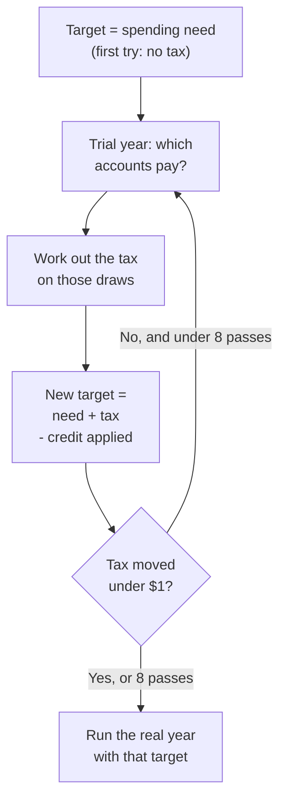

# How the math works: withdrawals

This page explains how RETIVO decides which accounts to take money from in each
year of retirement, in what order, and how the tax on those withdrawals is paid
for by more withdrawals. It is for anyone with basic personal-finance knowledge.
You do not need to read code. It says what the order depends on, the steps in
words, the figures this page uses and the year they apply to, and what the app
simplifies. It is an explanation of the model, not tax advice: the figures are
estimates built from what you entered.

It leaves out what other pages cover. How big an RMD or a QCD is, and what a
Roth conversion is, are on the
[retirement accounts page](math-retirement-accounts.md). Brackets, penalty rates
and the two MAGI income measures are on [the taxes page](math-taxes.md). IRMAA
tiers and ACA credit figures are on the
[Social Security and health costs page](math-social-security-and-health.md). How
spending, income and account growth are built is on the
[income, expenses and returns page](math-income-expenses-and-returns.md). How
the stress test builds its paths, and spending guardrails, are on the
projections page. For where these settings are on screen, see the user guide
section [What the cards do](user-guide.md#inside-a-scenario). For how the
calculation engine fits into the app, see [architecture.md](architecture.md).

## How a year runs

Each year of retirement goes through the same steps. The Planned, Historical and
stress-test projections use the same order. Only step 3 differs, as
[The stress test](#the-stress-test) explains.

1. **Charitable gifts first.** A QCD comes out of the IRA first and lowers that
   owner's IRA RMD. The rules are on the
   [retirement accounts page](math-retirement-accounts.md#charitable-distributions-qcds).
2. **The RMD comes out.** The forced withdrawal is taken from pre-tax money at
   the start of the year, whatever the strategy says. For a Mixed account only
   the pre-tax part is taken.
   [How big it is](math-retirement-accounts.md#required-minimum-distributions-rmds)
   is on the retirement accounts page.
3. **The year's tax is solved.** The app tries the year's withdrawals on a copy
   of your balances, works out the tax and adds it to what the year needs. See
   [The tax loop](#the-tax-loop).
4. **Any RMD surplus is put back.** The surplus is the RMD minus the year's
   spending need minus the year's tax need. It goes into a taxable account, or
   into a cash holding. See
   [When the RMD is larger than you need](#when-the-rmd-is-larger-than-you-need).
5. **Then each month, in this order:**
   1. Deposits are added and growth is applied.
   2. The month's need is its spending need plus its share of the tax need. The
      RMD already taken covers part of it, in proportion to the month's share of
      the year's spending need.
   3. Any held cash from step 4 is spent first, under every strategy.
   4. **HSA medical pass.** The HSA pays medical expenses. See
      [The HSA passes](#the-hsa-passes).
   5. **The strategy draws** from the ordinary accounts, in the order the next
      section describes, and under the **MAGI cap** if one is on.
   6. **HSA emergency pass.** The HSA is drawn for any need that remains, only
      after every other account is exhausted.
   7. **Last-resort drain.** If need still remains, account minimums are drained
      (see [Account limits](#account-limits)), so that a plan that truly runs
      out reaches $0.
6. **After the twelve months, a Fill conversion** uses whatever room is left
   under the MAGI cap. See [The MAGI cap](#the-magi-cap).

A year is marked as running out of money when its withdrawals fall short of
spending plus the tax need plus any conversion tax.

In the stress test, spending guardrails scale the year's spending before step 1.

**What the need is.** Each month's need is that month's expenses minus that
month's income, never below zero. A month where income is larger than spending
does not add anything to an account, and the extra is not carried to later
months. Deposits are different: one-off windfalls, pension lump sums and
contributions after retirement go into accounts in step 5.1 and do not lower the
need. See
[income](math-income-expenses-and-returns.md#income).

## Which accounts, and in what order

The **Withdrawal strategy** card has four choices.

| Strategy | First | Then | Last |
|---|---|---|---|
| **Tax-efficient** | Taxable accounts (Brokerage, Savings, Money Market, CD, and an Other or TSP set to post-tax) | Pre-tax and Mixed accounts | Roth accounts |
| **Roth first** | Roth accounts | Pre-tax and Mixed accounts | Taxable accounts |
| **Proportional** | One pool of every account except HSA, each giving in proportion to its balance | | |
| **Custom order** | The tiers you set, top tier first | | |

- A tier is used up before the next one is touched.
- Within a tier, accounts give in proportion to their balances. Only the balance
  above an account's minimum counts (see [Account limits](#account-limits)).
- A Mixed account gives from its pre-tax part and its after-tax part in
  proportion to what each part holds now.
- The order is by kind of account. The app does not compare the tax each choice
  would cost.
- HSA is held out of all three preset strategies. It is reached only through the
  two HSA passes.
- A Cash Balance Pension that pays an annuity or rolls over at retirement is not
  one of the accounts being drawn on.

### The HSA passes

- **Medical pass.** Each month the HSA pays up to the smallest of three amounts:
  the month's remaining need, that month's HSA-eligible medical expenses and the
  HSA balance. An expense counts when its category has the **Medical category**
  switch on and the expense has **Can be paid tax-free from an HSA** turned on.
  Money paid this way is tax-free. The pass runs only when there is a need, so a
  month where income covers spending leaves the HSA alone.
- **Emergency pass.** If every other account is exhausted and need remains, the
  HSA is drawn for it. The share of an emergency draw that counts as medical is
  the **Emergency HSA spending on medical care** setting, on the **HSA** tab of
  **Tax assumptions**. It is 100% unless you change it, and the rest is ordinary
  income and, before 65, carries an extra 20% tax. The rates and ages are on
  [the taxes page](math-taxes.md#early-withdrawal-penalties).

### Custom order

On the **Custom order** tab you arrange accounts into tiers.

- The top tier is drained first. Inside a tier, accounts drain one after another
  in the order you listed them, not in proportion.
- A new order starts with every account in **Tier 1** in list order, except HSA
  accounts, which start in **Excluded**. Every account must be in a tier or in
  **Excluded** before you can save.
- An **Excluded** account is never drawn for spending, for tax or for a
  conversion, and not even by the last-resort drain. Both HSA passes skip an
  excluded HSA. Two things still reach it: a forced RMD still comes out of an
  excluded pre-tax account, and an RMD surplus can still be deposited into an
  excluded taxable account.
- An HSA you put in a tier is drawn at that tier's place, and it still takes
  part in both HSA passes, so the medical pass pays from it first.
- A Cash Balance Pension account cannot be placed in the order.

## Account limits

The **Account limits** card sets a **Minimum balance** for an account. Only
taxable accounts and HSA accounts can have one.

- The amount is a fixed dollar figure. It is not adjusted for inflation, so its
  real value shrinks over a long retirement.
- Ordinary draws take only the balance above the minimum. What the account
  cannot give moves on to the next account, as if it were empty.
- When growth lifts the balance back above the minimum, the excess can be drawn
  again.
- **Last resort.** If need remains after every other source, including the HSA
  emergency pass, the minimums are drained. Non-HSA accounts go first, in tier
  order, and HSA accounts go last. An excluded account is never drained.
- **The MAGI cap and minimums.** Before the **MAGI cap** records a breach, it
  also drains the minimum of a taxable account in a later tier. It does not do
  this for an HSA.
- **HSA minimum, two modes.** With **Emergency only**, the default, the medical
  pass may take the HSA below its minimum and only emergency draws stop at it.
  With **Strict**, both stop at it, and the need moves to other accounts. An
  HSA placed in a custom tier keeps its full minimum in that tier's draw, in
  both modes. In both modes the last-resort drain can still go below it.

## The MAGI cap

The **MAGI cap** (the "income ceiling") is a yearly limit on pre-tax withdrawals
and conversions, set to keep your income under a chosen line. It is a tab on the
**Withdrawal strategy** card and works with every strategy.

**Windows.** The cap is a schedule of windows.

- A window starts at retirement, at a member's age or in a year. It ends at an
  age or in a year, and the end is not included: a window ending at age 65 stops
  the year before that member turns 65.
- Years are whole tax years. The editor does not allow windows to overlap. A
  year in no window has no cap: there is no limit and no conversion.
- A window tied to an age is never active if that member has no birth date.
- Each window has an **Annual Max**, a choice of **Which income line to track**
  (**Medicare (IRMAA) income** or **ACA marketplace income**) and a choice of
  **What to do with the cap room**. The **Annual Max** is the dollar figure you
  typed, used as is in every year of the window. It is not adjusted for
  inflation. The two income lines are on
  [the taxes page](math-taxes.md#the-two-income-measures-magi), and their
  thresholds are in the
  [IRMAA](math-social-security-and-health.md#medicare-surcharges-irmaa) and
  [ACA](math-social-security-and-health.md#aca-premium-credits) sections.

**How the limit is used.**

- Each capped year starts with a budget equal to the **Annual Max**. Every
  pre-tax dollar drawn uses some of it, and the RMD uses it first. RMD dollars
  above the **Annual Max** are a breach that cannot be avoided.
- Only pre-tax dollars use the budget. Taxable and Roth withdrawals do not. A
  taxable withdrawal still adds capital gains to MAGI, so it is not income-free.
  The income line you pick matters only to a Fill conversion.
- The budget is spent from the first month it is needed, so early months draw
  pre-tax and later months draw from other accounts.

When a tier holds pre-tax money, the router does these in turn:

1. It draws the tier's after-tax money first. In a pre-tax tier that is only
   the after-tax part of any Mixed account. The one **Proportional** pool holds
   every account, so there it is all after-tax money: taxable, Roth and the
   after-tax part of Mixed accounts.
2. It draws pre-tax money up to the budget that is left.
3. It sends the rest to the first account in a later tier that does not use up
   the cap: a taxable account, a Roth account, the after-tax part of a Mixed
   account, or an HSA placed in a later tier (down to its minimum). Accounts
   are drawn one after another in tier order. Earlier tiers are not searched
   again.
4. Only when none of those has money left, it draws pre-tax anyway and records
   a breach.

For example, with **Tax-efficient**, an **Annual Max** of $5,000, a $30,000
need, a brokerage account holding $10,000, a traditional IRA and a Roth IRA: the
brokerage gives $10,000, the IRA $5,000 and the Roth $15,000.

The tax on withdrawals is paid through the same routing. Once the cap is
reached, the money for tax comes from taxable and Roth accounts before more
pre-tax money.

**The two modes.**

- **Keep my income low** converts nothing. Withdrawals follow the routing above.
- **Fill the cheap tax room with Roth conversions** turns the room left after
  the twelve months into a Roth conversion to the **Roth account to receive
  conversions**.
  - The amount is found by a search, so that MAGI on your chosen line ends at or
    just under the **Annual Max**, within about a dollar and rounded down to the
    cent. It is never more than the unused budget. Gains from taxable
    withdrawals count in that MAGI, so they make the conversion smaller.
  - Nothing is converted when the RMD or the year's withdrawals already reach
    the **Annual Max**.
  - The tax it causes is paid only from Roth, Savings, Money Market, CD and HSA
    balances, and the Roth part of a Mixed account. It respects minimums and
    never uses an excluded account. An HSA draw here is taxed like an emergency
    HSA draw (see [The HSA passes](#the-hsa-passes)): only the **Emergency HSA
    spending on medical care** share is tax-free, so below 100% the rest adds
    to MAGI and can push it past the **Annual Max**. The target Roth is used
    last, and can give at most the balance it had before the conversion. The
    newly converted money never pays the tax. Tax these balances cannot cover
    makes the year run short.
  - A conversion carries no early-withdrawal penalty.
  - With no valid target (it must be your own Roth IRA, not an inherited one),
    Fill acts like **Keep my income low**. The scenario shows a notice.

What a Roth conversion is, and how converted money is taxed later, is on the
[retirement accounts page](math-retirement-accounts.md#retirement-fill-conversions).

## When the RMD is larger than you need

The RMD comes out in full whatever the year needs, and all of it is taxable
income. When it is more than the year needs:

- **The surplus** is the RMD minus the year's spending need minus the year's
  tax need. The RMD pays toward spending and tax first, and only the rest is put
  back.
- **It is put back** into the first taxable account the app finds: any
  post-tax account that is not Roth, including Savings, Money Market and CD. The
  app does not pick by size or tax, and an excluded account can still receive
  it. The deposit is a transfer, not new income.
- **With no such account**, the surplus goes into a cash holding that grows at
  0%, a fixed rule. It counts in your total balance. Later years spend it first,
  under every strategy.

For example, a $40,000 RMD with a $12,000 spending need and no tax leaves
$28,000 to put back.

## The tax loop

Withdrawals cause tax, the tax needs more withdrawals and those raise the tax
again. The loop runs only in the Planned and Historical projections.

Each pass:

1. **Run a trial year.** The twelve months run in the order above on a copy of
   your balances, with the RMD, held cash, HSA passes and cap, so the app sees
   which accounts the money would come from.
2. **Sort the draws** into four tax buckets: pre-tax, taxable, cash-like
   (Savings, Money Market, CD and HSA) and Roth.
3. **Run the full tax year on them:** federal tax, Social Security taxation,
   IRMAA and the ACA credit. Penalties and the HSA additional tax are part of
   the federal figure.
4. **Set the cash need** to federal tax plus the IRMAA paid in cash, minus the
   ACA credit, never below zero. Then work out the **credit applied to
   premiums**: the part of the credit left over, capped at the year's Medical
   expenses and at the draw the year would otherwise make (see
   [ACA premium credits](math-social-security-and-health.md#aca-premium-credits)).
5. **Set the next target** to the spending need plus the cash need plus the
   IRMAA withheld from Social Security, minus the credit applied to premiums.

IRMAA is fixed for the year, because it is based on income from two years
earlier. The part withheld from Social Security still has to be funded by the
portfolio, and the extra draw that covers it is taxed too. See
[the IRMAA section](math-social-security-and-health.md#medicare-surcharges-irmaa).

The loop stops when the cash need less the credit applied to premiums changes by
less than $1 from one pass to the next, or after 8 passes. These are fixed rules with no year attached. If it does
not settle, the last figures are used and no error is raised. The real year then
runs once, month by month, to that target.

If the settled year includes draws that carry a penalty, such as an early
withdrawal, a non-medical HSA draw or Roth earnings, the loop runs a second time
with those penalties included. The penalty amounts are taken from the first
round's mix of accounts and are not reworked inside the second.

### The stress test

The stress test runs no loop. Each path is run once with no tax to estimate each
year's tax. It is then run again with that tax added to spending, less the
credit applied to premiums, which is worked out from the same year's tax and so
can make the added amount negative. That is two passes and the tax is not
settled, so it is an estimate. Fill conversions are
sized and paid for as described under [The MAGI cap](#the-magi-cap).

## Built-in figures and years

This page has almost no yearly figures of its own. The QCD limit, RMD tables,
brackets, IRMAA tiers and ACA figures are on the earlier pages linked above.

| Figure | Built-in years | After the latest year |
|---|---|---|
| Tax loop stops when the cash need moves under $1, or after 8 passes | Fixed rule, no year | Unchanged |
| Share of an emergency HSA draw counted as medical: 100% | Default of a setting, no year | Unchanged |
| Share of a taxable withdrawal that is return of principal: 50% | Default of a setting, no year | Unchanged |
| Growth of held RMD cash: 0% | Fixed rule, no year | Unchanged |
| Fill search accuracy: about $1, rounded down to the cent | Fixed rule, no year | Unchanged |
| **Annual Max** and **Minimum balance** | Dollar figures you enter, no year | Never adjusted for inflation |

The return-of-principal setting is on the **Advanced** tab. It is explained on
[the taxes page](math-taxes.md#what-is-simplified-or-left-out).

## What is simplified or left out

- **Surplus income is not saved.** A month where income is larger than spending
  adds to no account, and the extra is not carried forward.
- **Minimums and the Annual Max are not adjusted for inflation.**
- **The cap counts pre-tax dollars, not MAGI.** Only a Fill conversion is sized
  against your chosen income line.
- **Taxable withdrawals use an assumed cost basis.** The gain share starts from
  the **Return of principal (taxable accounts)** setting, 50% unless you change
  it.
- **The loop funds an approximation of the tax shown.** Inside the loop the gain
  share stays at that starting figure and the assumed brokerage yield and
  cash-account interest are not included. On separate returns each return gets
  an even split of the draws. The tax shown for the year is worked out more
  exactly, so it and the tax the balances pay can differ a little.
- **The stress test uses two passes and no loop.**
- **Conversion tax paid from an HSA can add to MAGI.** The Fill search sizes
  the conversion before the tax is paid, and an HSA draw for that tax is taxed
  like an emergency draw. Below 100% **Emergency HSA spending on medical care**,
  the taxable share can leave MAGI above the **Annual Max** and, before 65, add
  the extra 20% tax.
- **The medical pass only sees marked expenses.** An expense in a medical
  category that is not marked **Can be paid tax-free from an HSA** is paid by the
  ordinary strategy.

## Worked example

Pat was born in 1950 and files Single for 2026, so Pat is 76. Pat uses
**Tax-efficient**. Pat has a traditional IRA that held $948,000 on Dec 31, 2025
and a brokerage account holding $10,000. Pat spends $60,000 a year ($5,000 a
month) and has no other income. To keep the numbers round, assume 0% growth and
0% inflation. There is no Medicare surcharge, because Pat's income two years
earlier was $60,000, under the first threshold. The brokerage is 50% return of
principal, the default.

1. **The RMD.** The divisor at 76 is 23.7, from the
   [retirement accounts page](math-retirement-accounts.md#which-life-expectancy-table).
   $948,000 divided by 23.7 is **$40,000**. It comes out first and covers
   $40,000 of the $60,000 need.
2. **The first try assumes no tax.** The other $20,000 comes from the brokerage
   first, which is $10,000 with $5,000 of it gain, and then $10,000 more from the
   IRA. Pre-tax money for the year is $40,000 + $10,000 = $50,000.
3. **The tax on that.** For 2026 the deduction is $16,100 plus the age-65 add-on
   of $2,050 plus the senior deduction of $6,000, which is whole because income
   is under $75,000. That is $24,150. Taxable ordinary income is $50,000 −
   $24,150 = $25,850. The tax is 10% of $12,400 = $1,240.00 plus 12% of $13,450 =
   $1,614.00, which is $2,854.00. The $5,000 of gain sits on top and is inside
   the 0% band, so it adds nothing. The brackets and bands are on
   [the taxes page](math-taxes.md#how-the-tax-is-worked-out).
4. **The loop.** Each pass funds the $60,000 need plus the last pass's tax. The
   brokerage is already empty, so each extra dollar of tax is drawn from the
   IRA. It adds to income taxed at 12%, so the tax rises by less each pass.

   | Pass | Target | Pre-tax money | Tax |
   |---|---|---|---|
   | 1 | $60,000.00 | $50,000.00 | $2,854.00 |
   | 2 | $62,854.00 | $52,854.00 | $3,196.48 |
   | 3 | $63,196.48 | $53,196.48 | $3,237.58 |
   | 4 | $63,237.58 | $53,237.58 | $3,242.51 |
   | 5 | $63,242.51 | $53,242.51 | $3,243.10 |

   From pass 4 to pass 5 the tax moves by $0.59, which is under $1, so the loop
   settles at **$3,243.10** after 5 passes.
5. **The real year.** The year draws $63,243.10: the $40,000 RMD, the whole
   $10,000 brokerage and $13,243.10 more from the IRA. The IRA ends at
   $894,756.90 and the brokerage at $0. There is no RMD surplus, because the RMD
   is below the need.

## Where the code lives

All paths are under `apps/web/src`.

- `lib/drawdown-engine-per-account-strategy.ts`: the yearly sequence
  (`runYearByYearStrategyAware`, `runOneStrategyYear`), including the RMD
  step, the tax step and the monthly order.
- `lib/drawdown-engine-per-account-strategy-helpers.ts`: the strategy tiers
  (`buildStrategyTiers`), the draw within a tier, account minimums and the
  choice of the active cap window.
- `lib/drawdown-engine-per-account-strategy-cap.ts`: the MAGI cap router, the
  deposits and growth for a month, and the trial year used by the tax loop.
- `lib/drawdown-engine-per-account-qcd-hsa.ts`: the QCD, RMD, held-cash, HSA
  and last-resort passes.
- `lib/drawdown-engine-per-account-magi-cap.ts`: builds each window's settings
  and the custom tiers.
- `lib/balance-projection-runner-drawdown.ts`: turns each window's start and end
  into years (`resolveMagiCapWindows`).
- `lib/balance-projection-runner-cashflow.ts` and
  `lib/expense-category-resolvers.ts`: the HSA-eligible medical expenses behind
  the medical pass.
- `lib/drawdown-engine-roth-conversion.ts`: the Fill conversion and how its tax
  is paid.
- `lib/tax-cashflow-solver.ts`: the tax loop and the Fill search.
- `lib/balance-projection-runner-tax.ts`: feeds the loop, including the second
  round for penalties.
- `lib/tax-integration.ts`: adds penalties and the HSA additional tax into the
  federal figure.
- `lib/monte-carlo.ts` and `lib/monte-carlo-tax.ts`: the stress test's two
  passes.
- `pages/scenario-withdrawal-strategy-shared.ts`,
  `pages/scenario-withdrawal-strategy-tier-editor.tsx`,
  `pages/ScenarioFloorsPage.tsx` and
  `pages/scenario-withdrawal-strategy-magi-cap.tsx`: the strategy labels, the
  **Custom order** tab, **Account limits** and the **MAGI cap** tab.
